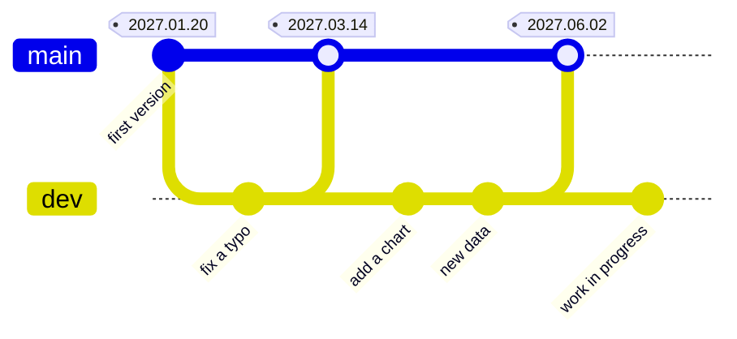
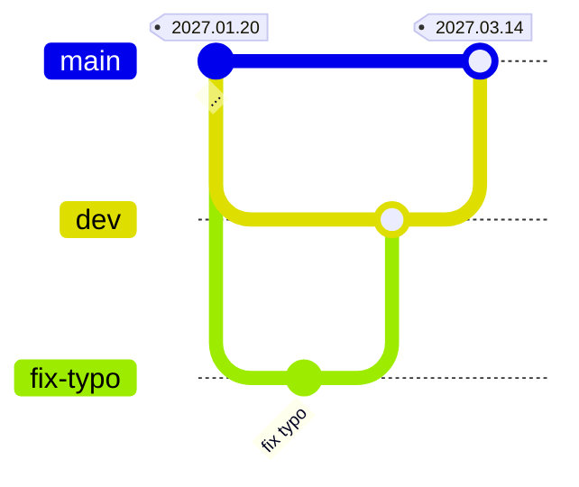
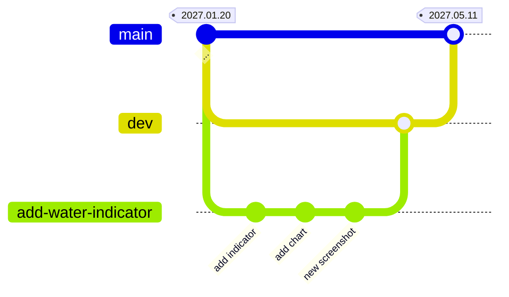
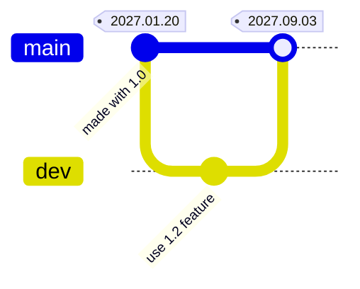
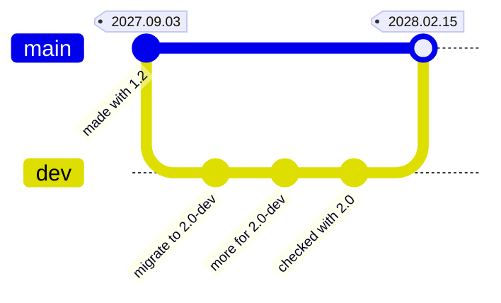
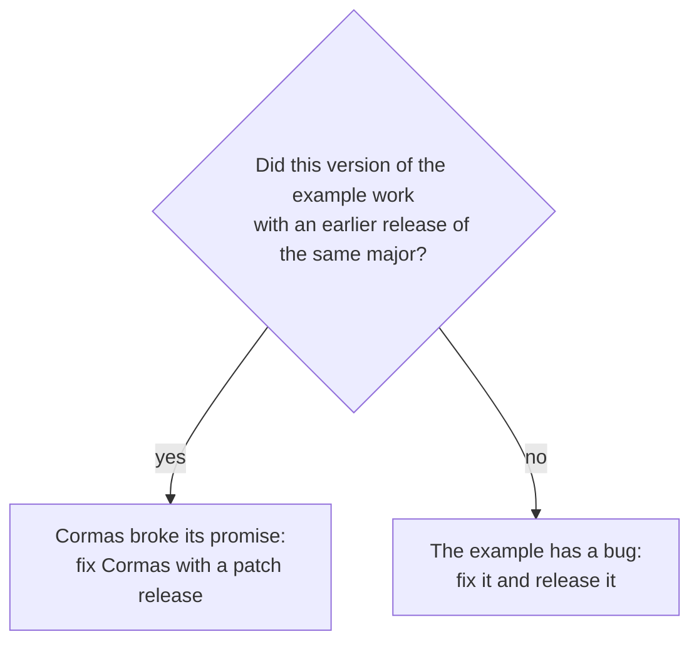
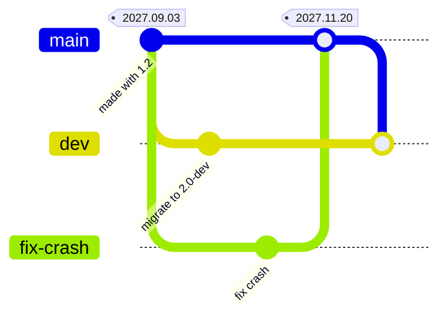
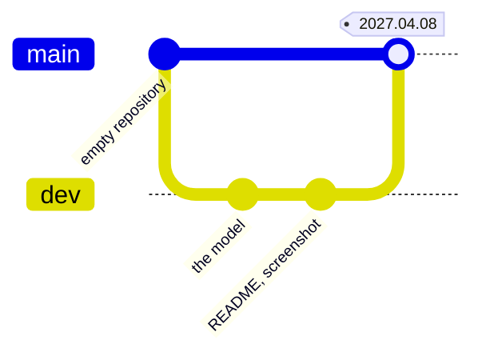
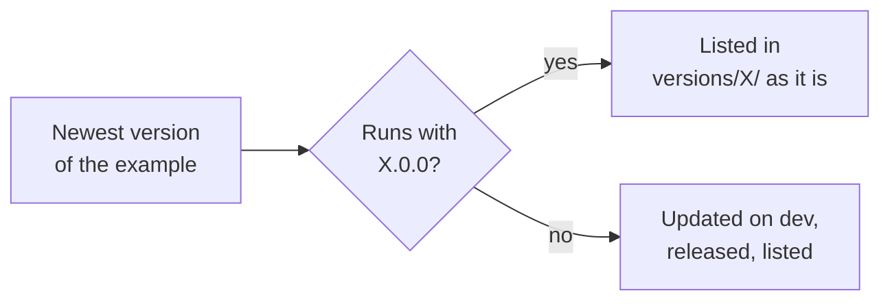

# Examples and the catalog

This page is for everyone who changes the example models of Cormas or their catalog. It explains how examples are kept, how to work on one, and what to do in the changes the community makes most often. What modelers see is described in [Workspace](../reference/workspace/index.mdx#examples) and [Versions](../reference/versions/index.mdx#versions-of-examples). How Cormas itself is released is described in [Releasing Cormas](./releasing-cormas.md).

The promise that matters here: **a release of Cormas always finds examples that run with it**, and a version of an example, once released, never changes. A modeler who installed Cormas 1.0 in 2027 must still be able to download the same examples years later, and get the same results. The promises start with Cormas 1.0.0, but follow this page already.

:::danger Never do this
- **Never move, delete or recreate a tag of an example.** Cormas downloads examples by their tags, and refuses a tag that no longer points to the commit it recorded.
- **Never commit to `main` of an example directly.** `main` changes only by merging a pull request, to release a version.
- **Never release an example you have not run** with the Cormas it is made with.
- **Never edit or remove a line of a released line** (`versions/1/models.txt`, `versions/2/models.txt`, ...). Lines are only appended to.
- **Never rename or delete a line folder** of the catalog, such as `versions/1/`.
- **Never delete an example repository, or make it private.** Archive it on GitHub instead: it stays downloadable.
- **Never edit `catalog.json` or `screenshots/` by hand.** They are generated.
- **Never change the `cormas` field of `cormas.json` by hand.** Only Cormas writes it.
:::

## The policy in one sentence

**To give a change of an example to users, merge `dev` into `main`, and publish a GitHub release of `main`, tagged with today's date.**

Everything else follows from it. There are no version numbers to choose: a small typo fix and a big new feature are released the same way, whenever they are ready, independently of the releases of Cormas. Examples use the same two branches as [Cormas itself](./releasing-cormas.md#the-two-branches).

## How examples are kept

### Each example is a repository

Each example is a git repository, such as [cormas/firefighters-model](https://github.com/cormas/firefighters-model), with:

- `cormas.json` and `screenshot.png` at its root, like every model folder (see [A model folder](../reference/workspace/index.mdx#a-model-folder)). The `cormas` field of `cormas.json` says which Cormas the example is made with; Cormas writes it whenever the example is changed;
- a `dev` branch, where all work happens. It is the default branch on GitHub, so that pull requests go to it;
- a `main` branch, which holds the released versions only. It changes only by merging `dev`, or a fix, to release a version;
- a **tag for each released version**, on `main`, named after the day of its release, such as `2027.03.14`. A second release on the same day is `2027.03.14.2`. A tag is never moved.



Here, three versions were released, on three days. The chart was released together with the new data. The work in progress waits on `dev`.

### The catalog lists the versions for each major

The catalog is the repository [cormas/example-catalog](https://github.com/cormas/example-catalog). It has one folder, called a **line**, for each major of Cormas, and one for the development version:

| Folder | Read by | Lists |
|---|---|---|
| `versions/dev/` | Cormas in development, such as `1.1.0-dev` | Each example once, with its branch `dev`. |
| `versions/1/` | Every release `1.x.y` | Released versions (tags) that run with Cormas 1, oldest first. |
| `versions/2/` | Every release `2.x.y` | The same, for Cormas 2. |

In each folder, `models.txt` lists one version per line, the URL of the repository and its tag or branch:

```text
https://github.com/cormas/firefighters-model 2027.01.20
https://github.com/cormas/firefighters-model 2027.03.14
```

A released version is **filed** in the line of the major it is made with: a version made with Cormas `1.2` is appended to `versions/1/`. The **Generate** workflow then builds `catalog.json` and `screenshots/` from `models.txt`, and the **Check** workflow checks every change.

Cormas `X.Y` offers the newest version listed in line `X` that is made with a Cormas no newer than `X.Y`. So a version made with Cormas `1.2` is offered to Cormas `1.2`, `1.3` and newer; Cormas `1.0` and `1.1` keep offering the version before it, which runs with them.

:::warning Not automatic yet
Filing a released version in its line will be done by a workflow of the catalog. Until it exists, file it by hand: after the release, open a pull request on the catalog that appends the URL and the tag to the `models.txt` of the line of its major, such as `versions/1/`.
:::

## Working on an example

An example downloaded by Cormas, in `Examples`, cannot be pushed back: Cormas treats a change to it as a new model of yours. To change the example itself, work on its repository, as on your own model:

1. Clone the repository of the example into `Models` of your workspace, with git or GitHub Desktop. It opens on `dev`.
2. Open the model list, and **Install** the example from My models. If the downloaded example is installed, uninstall it first: both have the same name.
3. Change the example in Cormas, and run it. Cormas writes every change to the folder, and records the Cormas you use in `cormas.json`.
4. Commit and push to a branch, and open a pull request into `dev`.

Use the latest release of Cormas, so that the change reaches as many users as possible.

### Releasing a version

Anyone with write access to the repository releases the changes merged into `dev`, once the example runs:

1. Open a pull request from `dev` into `main`, and merge it.
2. On GitHub, open **Releases → Draft a new release**.
3. In **Choose a tag**, type today's date, such as `2027.03.14`, and choose **Create new tag**. Keep **Target** on `main`.
4. Say in a few words what changed, and whether the results of the model change. Then **Publish release**.

Modelers get the new version with **Refresh**, in the model list.

## Common changes

Each case below shows the history of the example: work on `dev`, releases on `main`.

### Fixing a typo

A typo in a comment, the `README.md`, or the name of a chart.



1. Fix it on a branch, and open a pull request into `dev`.
2. Once merged, release it, or wait to release it with the next change. A typo can wait; a mistake that misleads modelers should not.

### Making an example better

New features, a new indicator or chart, a new parameter, new data, a cleaner model: all welcome.



1. Make the change on a branch, and open a pull request into `dev`.
2. Make sure the example still runs from start to end, and its tests pass.
3. If the example now looks different, update `screenshot.png`. If it is used differently, update `README.md`.
4. Release it. If the results of the model change, say so in the release: a modeler who compares with the earlier version must know why the results differ.

The earlier version stays in the catalog: a modeler who needs the old results chooses it with **Versions…**.

### Using a new feature of Cormas

A new release, such as Cormas `1.2`, brings a feature that makes an example simpler or better.



Change the example with Cormas `1.2`, and release it as usual. It is made with `1.2`, so Cormas `1.2` and newer offer it; Cormas `1.0` and `1.1` keep offering `2027.01.20`, which runs with them. Nothing else to do.

### A new release of Cormas, and the example still runs

Nothing to do. A patch or minor release never breaks an example, and it keeps offering the versions already listed. A new major is handled once, when it is released (see [Releasing Cormas](#releasing-cormas)).

### The example does not work with Cormas in development

`dev` of Cormas changes all the time, and examples are the first to notice.

- If the change in Cormas was meant to break models, the next release is a major (see [Releasing Cormas](./releasing-cormas.md#a-major-release-breaking-changes-are-needed)). Update the example on `dev` with that development version, as the migration guide will tell modelers to do. This also tests the migration guide. Do not merge it into `main` before the major is out.
- Otherwise, Cormas has a bug: [open an issue](https://github.com/cormas/cormas/issues) on Cormas, with the example and what fails. Do not change the example to work around it, since the models of modelers would break too.



Here, the example was migrated on `dev` while Cormas 2 was in development, and released on the day Cormas 2.0.0 came out. Until then, `main` stayed made with Cormas 1.

### The example does not work with a released Cormas

This must not happen, so find out first who is wrong:



**If the example worked with an earlier release**, such as `1.0` and not `1.1`, the minor release broke a model. That is a bug of Cormas, and the models of modelers are broken too. Open an issue on Cormas: it is fixed with a patch release (see [Releasing Cormas](./releasing-cormas.md#a-patch-release-a-bug-fix-that-users-need)). The example stays as it is.

**If the example has a bug**, fix it like a typo, and release it. Do it with the oldest release of Cormas that should get the fix: a fix made with Cormas `1.0` is offered to every `1.x`.

### A fix while `dev` is not ready to release

`dev` holds work that cannot be released yet, such as a migration to Cormas `2.0-dev`, but users need a fix now. Fix `main` directly, through a branch, as for a patch release of Cormas:



1. Create a branch from `main`, such as `fix-crash`.
2. Fix the bug there, with a release of Cormas 1.
3. Open a pull request into `main`, merge it, and release `main`. The version is made with Cormas 1, so it is filed in `versions/1/`.
4. Merge `main` into `dev`, so that `dev` gets the fix.

### Adding an example



1. Create the repository, with a `main` and a `dev` branch, and make `dev` the default branch on GitHub. Its name, the name of the model, must not be the name of another example of the catalog.
2. Give it, at its root, a `cormas.json` and a `screenshot.png`, made by Cormas (see [Workspace](../reference/workspace/index.mdx)), and a `README.md` that explains what the model is about.
3. In a repository of the `cormas` organization, copy `model-repository/notify-catalog.yml` of the catalog into `.github/workflows/`, so that the catalog is regenerated when the example changes.
4. Open a pull request on the catalog that adds the URL and `dev` to `versions/dev/models.txt`.
5. Release it as usual. It is filed in the line of the major it is made with.

### Removing an example

1. Open a pull request on the catalog that removes its line from `versions/dev/models.txt`. The next majors will not have it.
2. Leave the released lines as they are: releases that offered it keep offering it.
3. If nobody maintains the repository anymore, archive it on GitHub (**Settings → Archive this repository**). Never delete it.

### An example moved to another repository

Open a pull request on the catalog that corrects its URL, in every line that lists it. This is the only change allowed to an existing line of a released line.

### A tag was moved by mistake

Cormas refuses to download the moved tag, and **Generate** stops updating the line that lists it, which stays as it was. Put the tag back on the commit it pointed to: the catalog shows that commit in `catalog.json`. If that is not possible, release the fix as a new version.

## Protecting an example repository

In **Settings → Rules → Rulesets**, with an empty **Bypass list**, so that the rules also apply to administrators:

- a branch ruleset on `main` and `dev`, with **Require a pull request before merging** (0 required approvals), **Block force pushes** and **Restrict deletions**;
- a tag ruleset on all tags, with **Restrict updates** and **Restrict deletions**: a released version can never be moved.

## Releasing Cormas

When Cormas is released (see [Releasing Cormas](./releasing-cormas.md)), the catalog follows.

**A patch or minor release, `X.Y.Z`.** Nothing changes in the catalog. Versions of examples already made with `X.Y` were filed in line `X` when they were released, and are now offered.

**A major release, `X.0.0`.** The new line `versions/X/` is created. For each example in `versions/dev/models.txt`:

1. Take its newest released version. Run it and its tests with the release candidate.
2. If it works, it goes into line `X` as it is, even if it is made with an earlier major.
3. Otherwise, update the example on `dev` with the release candidate, and release it on the day of the release. It goes into line `X`.



## Changing the format of the catalog

Releases of Cormas read `catalog.json` for many years, so the meaning of its fields never changes. An incompatible change gets a new file name, such as `catalog-2.json`, generated next to `catalog.json`, which is still generated for as long as releases read it. Cormas refuses a format it does not know.

In the catalog repository, the lines (`versions/`) are kept apart from the tools that generate them (`tools/`): a change to the tools never changes a line by hand.
