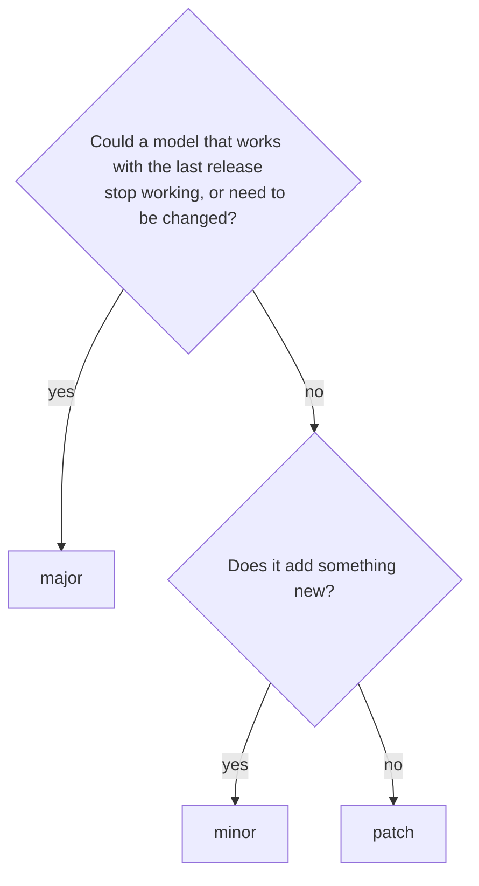
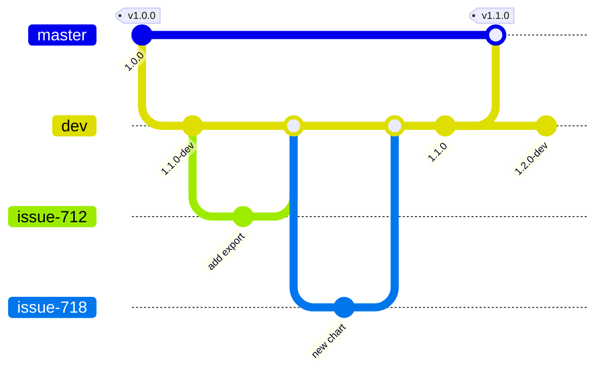
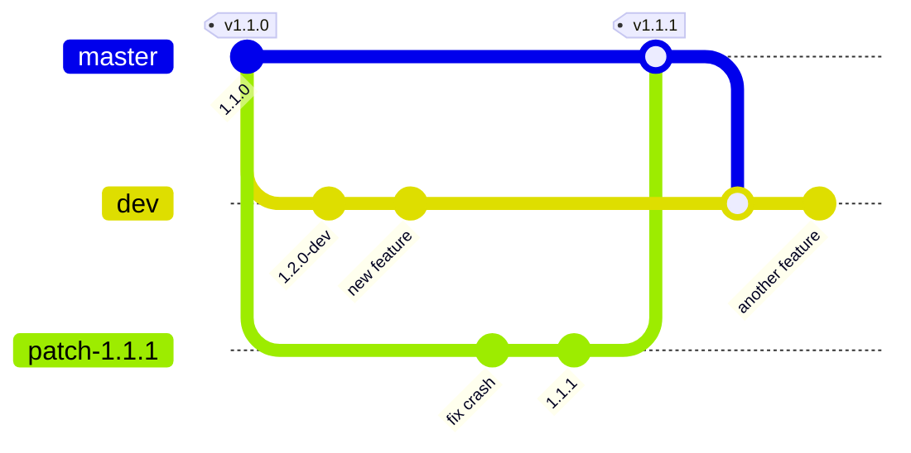
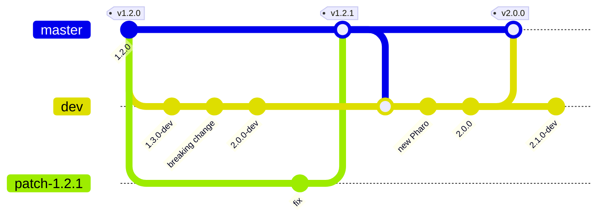

# Releasing Cormas

This page is for everyone who changes the code of Cormas. It explains how versions of Cormas are numbered, how the two branches of the repository are used, and when and how to make each kind of release. Following it is what lets Cormas keep its promises to modelers, described in [Versions](../reference/versions/index.mdx). The examples and their catalog have their own page: [Examples and the catalog](./examples-and-catalog.md).

:::warning Not guaranteed yet
The promises start with Cormas 1.0.0. Follow this page already, but three things must be done before that release:

- fix every dependency of Cormas to an exact version: the baseline of Cormas still loads some of them from branches;
- archive each release, with a DOI: the virtual machine, the image, the sources, the catalog line and the examples;
- publish a checksum of every file of a release.
:::

## What we promise

Modelers can count on three things:

1. A model keeps running, exactly as it was, with the release of Cormas it was made with, for many years.
2. Patch and minor releases of Cormas never break a model.
3. A model moves to a new major release only when its modeler decides to migrate it.

Every rule on this page serves these promises. A modeler who publishes a paper relies on them: if a patch release breaks a model, the paper's model no longer runs with the "safe" update we told them to install.

:::danger Never do this
- **Never commit to `master` directly.** `master` changes only by merging a pull request, for a release.
- **Never move or delete a release tag, and never reuse a version number.** `v1.0.0` must point to the same code forever: papers cite it.
- **Never put a breaking change in a patch or minor release.** If a model that worked can stop working, or must be changed, the release is a major.
- **Never change the version of Pharo in a patch or minor release.**
- **Never release Cormas with a dependency loaded from a branch.** Every dependency of a release is fixed to an exact version, so that installing the release always gives the same code.
- **Never make Cormas update itself**, or update a model or an example without the modeler asking.
- **Never delete a release**, from GitHub or from its archive.
:::

## Version numbers

A version of Cormas has three numbers, `major.minor.patch`, such as `1.4.2`. This scheme is called *semantic versioning*: each number tells modelers what an update means for their models.

| Release | Example | Contains | Effect on models |
|---|---|---|---|
| **patch** | `1.4.2` → `1.4.3` | Bug fixes only. | None, except that the bugs are gone. |
| **minor** | `1.4.3` → `1.5.0` | New features, and possibly bug fixes. | None: every model keeps working, unchanged. |
| **major** | `1.5.0` → `2.0.0` | Changes that can break models. | Models must be migrated, following the migration guide of that major. |

When a number goes up, the numbers to its right go back to zero: after `1.4.3` come `1.4.4`, `1.5.0` or `2.0.0`.

### What kind of change is it?

Ask this question for every change, before it is merged:



A change **breaks models** when a model that worked has to be changed to keep working. These are breaking changes, so they belong to a major:

- removing or renaming a class or a method that models use, such as a method of `CMAgent` or `CMSpatialEntity`;
- changing the arguments a method takes;
- changing what a method returns, or a default value that models rely on, such as the default size of a grid;
- moving Cormas to a newer version of Pharo;
- updating a dependency to a version that breaks models.

These changes are **new features**, so they belong to a minor:

- a new method, class, probe, chart or tool;
- a new optional argument, with a new message, while the old message keeps working;
- a better interface, as long as models do not have to change.

These changes are **bug fixes**, so they belong to a patch: a crash, a wrong result, a broken button, a typo in an interface.

A bug fix may change the results of a model, since the model was using the bug. That is still a patch, but say so in the release notes, so that modelers can check their results.

:::tip[Avoiding a breaking change]
Most breaking changes can wait. To rename a method, add the new one, and keep the old one, sending the new one and marked as deprecated. That is a minor change. The old method is removed later, in the next major, and its migration guide says how to replace it.
:::

## The two branches

The repository [cormas/cormas](https://github.com/cormas/cormas) has two long-lived branches: `master` and `dev`.



### `master`: releases only {#master}

`master` holds the releases, and nothing else. It changes only when a release is made, by merging a pull request. Every merge into `master` is a release, and gets a tag, such as `v1.1.0`. Modelers who install Cormas get `master`.

Nobody commits to `master` directly: a commit there would reach modelers without being tested and released. GitHub can enforce this, even for the administrators of the repository, with a **ruleset**:

1. In the repository, open **Settings → Rules → Rulesets → New ruleset → New branch ruleset**.
2. Name it, set **Enforcement status** to **Active**, and add the target branch `master`.
3. Leave the **Bypass list** empty: the rules then also apply to administrators.
4. Check **Restrict deletions**, **Require a pull request before merging** (with 0 required approvals, so that a maintainer can merge alone), and **Block force pushes**.

Do the same for the tags: a **New tag ruleset** targeting `v*`, with **Restrict updates** and **Restrict deletions**, so that a release tag can never be moved or deleted.

Administrators can still change or disable a ruleset in the settings. The ruleset prevents mistakes; it does not replace the rule.

### `dev`: the work in progress {#dev}

`dev` is where Cormas is developed. It is always called `dev`, and there is only one. Every change reaches it through a pull request, from a branch made for one issue, as described in [How to Contribute](./contribute/index.md). Iceberg names that branch after the issue, such as `712-Add-export-option`.

`dev` must always load and pass its tests: anyone may install it at any moment.

The version written on `dev` is the version of the next release, followed by `-dev`, such as `1.1.0-dev`. It is the string returned by `CMVersion class>>current`:

```smalltalk
current
	^ self fromString: '1.1.0-dev'
```

When a pull request changes the kind of the next release, raise this version in the same pull request:

- the first new feature after a release: `1.0.1-dev` becomes `1.1.0-dev`;
- the first breaking change after a release: `1.1.0-dev` becomes `2.0.0-dev`.

The version is never lowered. Once `dev` holds a breaking change, the next release from `dev` is a major.

`dev` is merged into `master` only to make a minor or a major release.

## When to release

There is no fixed calendar. Make each kind of release when its moment comes.

### A patch release: a bug fix that users need

Make a patch release as soon as a fixed bug hurts modelers who use the current release, such as a crash or a wrong result. Do not wait for the next minor release.

A patch is made from `master`, not from `dev`, because `dev` may already hold new features or breaking changes that must not be part of a patch:



1. Create a branch from `master`, named after the release, such as `patch-1.1.1`.
2. Fix the bug there, with a test that fails before the fix. If the fix is already on `dev`, cherry-pick it.
3. Set the version to `1.1.1` in `CMVersion class>>current`.
4. Follow [Making a release](#making-a-release), with a pull request from `patch-1.1.1` into `master`.
5. Merge `master` into `dev`, so that `dev` gets the fix. The version on `dev` conflicts: keep the version of `dev`.

### A minor release: new features are ready

Make a minor release when `dev` holds new features that are finished, tested and worth giving to modelers, and no breaking change. A few times a year is a good rhythm; releasing small and often is easier than releasing big and rarely.

1. Set the version on `dev`, such as `1.1.0` instead of `1.1.0-dev`.
2. Check the examples with it (see [Examples and the catalog](./examples-and-catalog.md#releasing-cormas)).
3. Follow [Making a release](#making-a-release), with a pull request from `dev` into `master`.
4. Set the version on `dev` to the next one, such as `1.2.0-dev`.

### A major release: breaking changes are needed

Make a major release when Cormas needs changes that break models, or needs to move to a newer Pharo. A major release can be prepared for a long time: once `dev` holds its first breaking change, its version becomes `X.0.0-dev`, and modelers get no more minor releases until the major is out. Meanwhile, bugs are still fixed with patch releases from `master`.

**A major release must work on the latest stable Pharo at the time of its release.** Since the version of Pharo changes only with a major, every major is the moment to catch up with Pharo.



1. Move `dev` to the latest stable Pharo, and check that everything works there.
2. Write the migration guide: for each breaking change, what a modeler must change in a model, with the code before and after. It is published on this website with the release.
3. Set the version on `dev`, such as `2.0.0`.
4. Update the examples for the new major, and create its line in the catalog (see [Examples and the catalog](./examples-and-catalog.md#releasing-cormas)).
5. Follow [Making a release](#making-a-release), with a pull request from `dev` into `master`.
6. Set the version on `dev` to the next one, such as `2.1.0-dev`.

After a major release, the previous major gets no more releases, but it stays available and runnable: models made with it keep working with it. If a serious bug must still be fixed in it, create a branch `1.x` from its last tag, and make its patch releases from that branch in the same way.

## Making a release

These steps are the same for every release. The pull request into `master` is ready when the version is set (without `-dev`), the tests pass, and the examples work.

1. **Fix the dependencies.** In the baseline of Cormas, every dependency is loaded at an exact version, a tag or a commit, never a branch.
2. **Open a pull request** into `master`, from `dev` or from the patch branch. Title it with the version, such as "Release 1.1.0".
3. **Merge it**, with a merge commit (not a squash), so that `master` keeps the history of `dev`.
4. **Tag the merge commit** on `master` with `v` and the version, such as `v1.1.0`, by creating a **release** on GitHub with that tag.
5. **Write the release notes** in the GitHub release: the bug fixes, the new features, and for a major, the breaking changes with a link to the migration guide. Say which fixes may change the results of models.
6. **Archive the release** on Zenodo, which gives it a DOI: the virtual machine, the image, the sources, the catalog line and the examples. Add the DOI to the release notes.
7. **Publish the checksums** of the archived files, in a file `SHA256SUMS` attached to the release, made with `shasum -a 256 * > SHA256SUMS` in the folder of the files.
8. **Move `dev` to the next version**, such as `1.2.0-dev`, or merge `master` into `dev` after a patch.

Results made with a development version of Cormas are not meant to be published: only a release is archived and can be cited.
