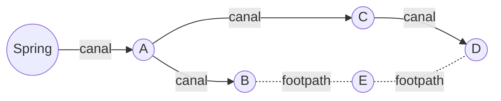
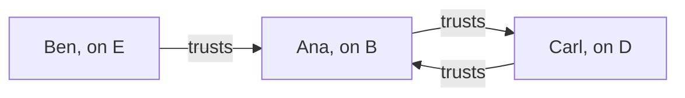
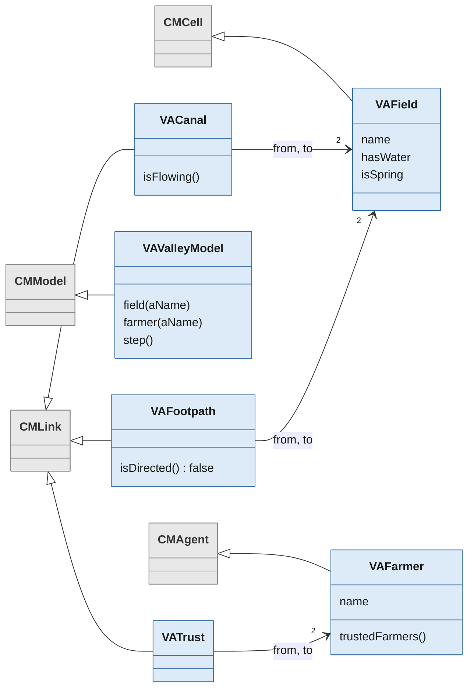

import valleyImg from './img/valley.png'
import valleyPointsOfViewImg from './img/pointsOfView.png'
import valleyWaterImg from './img/waterFlowing.png'

# Links

A **link** connects two entities: a road between two cells, a canal from one field to another, the trust of one farmer in another, or a person's attachment to their home. A link is an entity in its own right. It has its own attributes, its own behaviour and its own points of view, and it is drawn as a line on the grid.

This page explains everything you can do with links. When you want to treat many links as one thing, such as a street made of roads or a river made of segments, read [Networks](../networks/index.mdx) next.

## The example: a valley

Every example on this page uses the Valley model, a small model you can load and run. To load it, open a Playground in your Cormas image and execute:

```smalltalk
Metacello new
    repository: 'github://cormas/valley-model:main/src';
    baseline: 'ValleyModel';
    load.
```

The valley is a grid of 10 by 10 fields. Water rises at a spring and flows through irrigation canals, always in one direction. Footpaths join some fields, and people walk along them both ways. Three farmers stand on their fields, and some of them trust others. Canals, footpaths and trust are three kinds of links.

Six fields have names: the spring, A, B, C, D and E. Water flows from the spring to A, from A to B and to C, and from C to D, as the arrows show on the diagram below. Footpaths join B to E and E to D, drawn as dotted lines with no arrow, because people walk them both ways. No canal reaches E: only footpaths go there.



Ana stands on B, Ben on E and Carl on D. Trust goes from the farmer who trusts to the farmer who is trusted, as the arrows show on the diagram below.



Ben trusts Ana, but Ana does not trust Ben. Ana and Carl trust each other.

Before the first step, only the spring has water. Every cell of the grid is a field, and all the others are dry, as can be seen in the simulation below: the spring is the blue field near the top left corner, and the dry fields are brown. Canals are blue lines with arrowheads, footpaths are thin brown lines, the farmers are dark dots, and trust is thin purple lines between them, with an arrowhead at the farmer who is trusted.


To try the examples, get a valley and some of its fields and farmers:

```smalltalk
valley := VAValleyModel exampleValley.
a := valley field: 'A'.
d := valley field: 'D'.
e := valley field: 'E'.
ana := valley farmer: 'Ana'.
ben := valley farmer: 'Ben'.
```

To see what a message returns, select an expression such as `a nextEntities` and choose Print it (Ctrl+P).

The model has five classes of entities. The grey classes come from Cormas, and the blue ones belong to the model:



At each step, water moves one canal further from every field that has water, and a farmer's field gets water when a farmer they trust has water. So Ben's field E, which no canal reaches, gets water through Ana.

After two steps, water has reached A, B and C, which turn green, as can be seen below. D and E are still dry: D gets water from C at the next step, and E gets it at the same time, through Ben's trust in Ana.


## What can be linked

A link connects two **things**: cells, agents and aggregates. It can join two things of the same kind, such as two fields or two farmers, or of different kinds, such as a farmer and a field.

A link cannot be the end of another link. Neither can a network. Cormas organizes connections in three levels: things, links between things, and networks of links. [Networks](../networks/index.mdx#things-links-and-networks) explains the three levels.

To check whether an entity can be the end of a link, send it the message `isLinkable`:

```smalltalk
a isLinkable.       "true, a field is a cell"
ana isLinkable.     "true, a farmer is an agent"
```

## Making a link class

Each kind of link in your model is a class, like each kind of cell or agent. Make it a subclass of `CMLink` in your model's package, so that Cormas finds it:

```smalltalk
CMLink << #VACanal
    package: 'Valley-Model'
```

Like any entity, a link class can have attributes, such as the wear of a road, and methods, such as `isFlowing` on a canal.

### Direction

A link goes **from** one end **to** the other. By default, a link is **directed**: it can only be followed from its `from` end to its `to` end, like a canal, where water only flows downhill.

When the direction doesn't matter, as for a footpath that people walk both ways, redefine the method `isDirected` in your link class so that it returns false:

```smalltalk
VAFootpath >> isDirected
    ^ false
```

The method `isDirected` can also return the value of an attribute. In the [Road Traffic model](/models/road-traffic), a road is directed only when it is one-way:

```smalltalk
RTRoad >> isDirected
    ^ self isOneWay
```

Nothing else is needed. All the messages on this page that access links follow the direction, so people can't drive the wrong way along a one-way road.

## Creating a link

To create a link, send the message `newEntity:from:to:` to your model. The examples in this section add links to the valley, so get a fresh one with `valley := VAValleyModel exampleValley` before trying the next sections.

```smalltalk
valley newEntity: VAFootpath from: a to: d.
```

Each keyword of the message takes an argument:

| Keyword | Its argument |
|---|---|
| `newEntity:` | The class of the link, such as `VAFootpath` |
| `from:` | The first end: a cell, an agent or an aggregate of this model. A directed link starts here |
| `to:` | The second end. A directed link arrives here |

It returns the new link, so you can keep it in a variable or set its attributes:

```smalltalk
canal := valley newEntity: VACanal from: d to: e.
```

Inside an entity's own methods, send the message to its model: `self cormasModel newEntity: VATrust from: self to: otherFarmer`.

Some links are refused at once, with an error that says why:

| You try to link | Result |
|---|---|
| An entity to itself, as in `valley newEntity: VAFootpath from: a to: a` | Error: *A link must connect two different entities* |
| An entity of another model, or one that was already removed | Error: *… cannot be linked because it is not in this model* |
| `nil` | Error: *nil cannot be linked because it is not in this model* |
| A link or a network | Error: *… cannot be linked because only things such as cells, agents and aggregates can be the ends of a link* |
| The same two entities twice | Allowed. You get two links |
| A dead agent that has not been removed yet | Allowed |
| An agent that is not on the grid | Allowed. The link exists but isn't drawn |

:::tip
Don't create a link by sending `newEntity:` alone. A link needs its two ends, and without them it fails the first time you use it.
:::

## The ends of a link

Take the canal from C to D, the only canal arriving at D:

```smalltalk
canal := (d incomingLinksOfClass: VACanal) first.
```

| Message | Returns | Example | Result |
|---|---|---|---|
| `from` | The first end | `canal from` | field C |
| `to` | The second end | `canal to` | field D |
| `ends` | Both ends, as a new collection | `canal ends` | C and D |
| `otherEndOf:` | The end that is not the argument | `canal otherEndOf: d` | field C |
| `isDirected` | Whether the link goes one way only | `canal isDirected` | `true` |
| `length` | The number of cells between its ends | `canal length` | `5` |

`otherEndOf:` is handy when you have one end and want the other, for example to walk along a link without caring about its direction. It raises an error if its argument isn't an end of the link: `canal otherEndOf: a` fails, because A is not an end of this canal.

On a link that isn't directed, `from` and `to` are just the order of creation, and have no other meaning.

The ends of a link never change. To connect something else, delete the link and create a new one.

### Length

`length` counts the steps between the ends, as an agent would walk on this grid. The valley's grid has 4 neighbours, so a diagonal counts as two steps. The canal from A, in row 2 and column 5, to C, in row 6 and column 4, has a length of 5: 4 rows and 1 column.

`length` works between cells, agents and aggregates. When an end is not on the grid, there is nothing to measure, so `length` raises an error.

## Accessing links and linked entities

Cormas offers 24 messages that you can send to a cell, an agent or an aggregate to access its links and the entities linked to it. They follow one pattern, so you only need to learn the pattern.

**1. Do you want links, or the entities at their other ends?**

- `links` returns the links themselves, for example to read their attributes.
- `linkedEntities` returns the entities at the other ends, for example to visit them.

**2. One step, or all the way?**

- Without `all`, the message looks only at the links touching the entity.
- With `all`, it follows links again and again, from entity to entity, as far as it can go: everything reachable.

**3. In which direction?**

- **Either direction:** every link, whichever way it goes.
- **Forward**, following the arrows: `outgoing`, `next` and `downstream`.
- **Backward**, against the arrows: `incoming`, `previous` and `upstream`.

**4. All kinds of links, or one kind?** Each message has a second version that takes a link class as its argument. That version follows only the links of this class and its subclasses.

Here are the 12 messages that follow all kinds of links, each sent to field A, with the result it returns:

| | Either direction | Forward | Backward |
|---|---|---|---|
| **Links, one step** | `a links`: Spring→A, A→B, A→C | `a outgoingLinks`: A→B, A→C | `a incomingLinks`: Spring→A |
| **Entities, one step** | `a linkedEntities`: Spring, B, C | `a nextEntities`: B, C | `a previousEntities`: Spring |
| **Links, all the way** | `a allLinks`: all 6 canals and footpaths | `a allDownstreamLinks`: A→B, A→C, B–E, C→D, E–D | `a allUpstreamLinks`: Spring→A |
| **Entities, all the way** | `a allLinkedEntities`: Spring, B, C, E, D | `a allDownstreamEntities`: B, C, E, D | `a allUpstreamEntities`: Spring |

And here are the 12 messages that take a link class as their argument:

| | Either direction | Forward | Backward |
|---|---|---|---|
| **Links, one step** | `linksOfClass:` | `outgoingLinksOfClass:` | `incomingLinksOfClass:` |
| **Entities, one step** | `entitiesLinkedBy:` | `nextEntitiesLinkedBy:` | `previousEntitiesLinkedBy:` |
| **Links, all the way** | `allLinksOfClass:` | `allDownstreamLinksOfClass:` | `allUpstreamLinksOfClass:` |
| **Entities, all the way** | `allEntitiesLinkedBy:` | `allDownstreamEntitiesLinkedBy:` | `allUpstreamEntitiesLinkedBy:` |

For example:

```smalltalk
a nextEntitiesLinkedBy: VACanal.             "B and C"
a allDownstreamEntitiesLinkedBy: VACanal.    "B, C and D: every field the water from A can reach"
d allUpstreamEntitiesLinkedBy: VACanal.      "C, A and Spring: where D's water comes from"
d entitiesLinkedBy: VAFootpath.              "E"
e nextEntitiesLinkedBy: VACanal.             "empty: no canal leaves E"
ben nextEntitiesLinkedBy: VATrust.           "Ana, the farmer Ben trusts"
ana previousEntitiesLinkedBy: VATrust.       "Ben and Carl, the farmers who trust Ana"
```

### Why the link class matters

Look again at `a allDownstreamEntities`: it returns B, C, E and D. But water can't reach E, because no canal goes there. Without a link class as its argument, the message followed the footpaths from B and D as well.

The message you need is `a allDownstreamEntitiesLinkedBy: VACanal`, which returns B, C and D.

:::tip
In a model with more than one kind of link, use the messages that take a link class as their argument. A message that follows all kinds of links returns a different result as soon as you add a new kind of link to your model.
:::

### Links that go both ways

A link that isn't directed counts as going forward and backward for both its ends. Field E has two footpaths, so:

```smalltalk
e outgoingLinks.     "B–E and E–D"
e incomingLinks.     "B–E and E–D, the same two"
e nextEntities.      "B and D"
e previousEntities.  "B and D"
```

Field D has a canal arriving from C and a footpath to E, so `d nextEntities` returns E only, and `d previousEntities` returns C and E.

### Links between agents

You can send the same messages to agents. Trust between farmers is directed, so:

```smalltalk
ana nextEntities.         "Carl: Ana trusts Carl"
ana previousEntities.     "Ben and Carl: they trust Ana"
ana linkedEntities.       "Ben and Carl, each once"
ben previousEntities.     "empty: nobody trusts Ben"
ben allDownstreamEntities.  "Ana and Carl: the trust that starts from Ben reaches them"
```

Standing on a field is not a link. Ana stands on B, but `(valley field: 'B') linkedEntities` doesn't include Ana. To find where an agent is, send it the message `cell`, as usual.

### The rules these messages follow

- Each message returns a **new collection**. You can delete links or entities while you loop over it.
- Each entity and each link appears **once**, even when it can be reached in several ways.
- The results of `all` messages come **nearest first**, and always in the same order.
- The entity that receives the message is **never part of the result**. But a link that leads back to it is: `ana allLinks` includes Carl→Ana.
- These messages **go through** dead agents and things that are not on the grid. Check `isDead` yourself when it matters.
- When there are no such links or entities, the message returns an **empty collection**, never `nil`.

## Walking along a link

A link is drawn as a straight line from the center of one end to the center of the other. An agent can walk exactly on this line, by any distance at a time, with two messages that you send to the agent:

| Message | What it does |
|---|---|
| `moveStraight:towards:` | Moves the agent along the straight line from where it is to the center of a cell, by a distance, and never beyond that center |
| `isAtCenterOf:` | Returns whether the agent has reached the center of a cell |

The keywords of `moveStraight:towards:` and their arguments:

| Keyword | Its argument |
|---|---|
| `moveStraight:` | How far to move, where the width of one cell is 1. It can be a fraction, such as `0.25` for a quarter of a cell |
| `towards:` | The cell whose center the agent moves towards, usually the other end of the link |

For example, Ana stands at the center of B, and a footpath leads from B to E, 7 cells further down. Ana walks the whole footpath, one cell at a time:

```smalltalk
path := (ana cell linksOfClass: VAFootpath) first.
target := path otherEndOf: ana cell.     "field E"
[ ana isAtCenterOf: target ] whileFalse: [
    ana moveStraight: 1 towards: target ].
ana cell name.     "'E', after 7 moves"
```

In a model, an agent usually moves a little at each step, so it keeps the cell it is walking to in an attribute. Get the other end of the link when the agent sets off, because the agent's own cell changes on the way. In the [Road Traffic model](/models/road-traffic), a person walks along a road like this, more slowly on a worn road:

```smalltalk
self moveStraight: speed / road wear towards: roadEnd.
(self isAtCenterOf: roadEnd) ifTrue: [ "choose the next road" ]
```

Some things to know:

- As the agent moves, it enters the cell where its new position falls. When it moves more than one cell at a time, it passes over the cells in between without entering them.
- The line takes no account of what is on the grid, such as walls or other agents.
- The agent must be on the grid, or `moveStraight:towards:` raises an error.
- The lines of the agent's own links follow it as it moves, because a link ends where the agent is drawn.
- `moveTowards:` is different: it moves the agent from cell to neighbouring cell, so on a sloping link the agent leaves the line and comes back to it.

## All the links of a model

To get every link of your model, of every class, send `links` to the model:

```smalltalk
valley links.     "the 4 canals, 2 footpaths and 3 trusts"
valley links size.     "9"
```

To get the links of one class, send `@@` to the model with the class as its argument, as for any entity: `valley @@ VACanal`.

## The life of a link

| What happens | The link |
|---|---|
| You send `delete` to the link | Is removed at once. Its ends are not affected |
| An end is removed from the model, for example when an agent receives `die` or `delete` | Is removed at once, by Cormas |
| An agent at one end receives `isDead: true` | Stays until the agent is removed at the end of the step. A dead agent leaves the grid at once, so the link isn't drawn meanwhile |
| An end leaves the grid, for example with `leave` | Stays, and is still returned by the messages above, but isn't drawn |
| The simulation is initialized again | Is removed, like every other entity |

For example:

```smalltalk
(ben outgoingLinksOfClass: VATrust) do: [ :trust | trust delete ].
ben nextEntities.     "empty: Ben trusts nobody now"
```

```smalltalk
valley := VAValleyModel exampleValley.
ana := valley farmer: 'Ana'.
valley links size.    "9"
ana die.
valley links size.    "6: the 3 trusts of Ana are gone with her"
```

Links have no `step` of their own. If your links change over time, such as roads that wear, your model's control method changes them, as it does for cells and agents.

## How links look

A link is drawn as a straight line between its two ends. It is drawn only when **both ends are on the grid**:

- the end of a cell is its center;
- the end of an agent is where the agent is drawn;
- the end of an aggregate is the average of the centers of its cells.

A directed link has an **arrowhead** at its `to` end, in the color of the line.

Cormas draws cells first, then aggregates, then links, then agents, so agents stay on top of lines.

### Points of view

A link's point of view sets two things:

| In the point of view | For a link |
|---|---|
| `color:` | The color of the line and of its arrowhead |
| `size:` | The thickness of the line, as a fraction of a cell: `0.1` is a tenth of a cell |

Other settings of a point of view, such as `shape:` or a border, are ignored for links.

```smalltalk
VACanal >> pov
    <pov>
    ^ CMPointOfView color: (Color fromHexString: '1F5FBF') size: 0.15
```

A point of view can depend on the link, as for any entity. This one makes a canal wide while water flows through it:

```smalltalk
VACanal >> povWater
    <pov>
    self isFlowing ifTrue: [
        ^ CMPointOfView color: (Color fromHexString: '1F5FBF') size: 0.4 ].
    ^ CMPointOfView color: (Color fromHexString: '9A9A9A') size: 0.08
```

With `povWater` selected for canals and `povInvisible` for trust, the canals show where water flows. After one step, water has reached A, so the canals leaving the spring and A carry water, and are wide and blue, as can be seen below. C is still dry, so the canal from C to D is thin and grey. Trust is hidden, which makes the farmers easier to see.


Every link class also inherits these points of view from Cormas, so you don't have to define them:

| Point of view | Shows |
|---|---|
| `pov` | A thin dark line, until you define your own `pov` method |
| `povInvisible` | Nothing. The link is still there, and is still returned by the messages above |
| `povId` | A color for each link, from its id |
| `povClassName` | One color for all the links of the class |

`povInvisible` is useful when lines would hide the rest of the map. In the Road Traffic model, the links from people to their homes and workplaces are hidden at the start for this reason.

Choose a point of view in the simulation window, as for cells and agents.

## Using the mouse

- **Right-click** on a line to open the menu of its link: Inspect, Browse, and Remove, which deletes the link.
- **Left-click** goes through the line to the cell underneath, so tools that act on cells keep working.
- A link can't be dragged. When you drag an agent, its links follow it.

## Tips and common mistakes

- **Use the messages that take a link class as their argument** when your model has more than one kind of link. See [Why the link class matters](#why-the-link-class-matters).
- **Check for empty results.** `(ben nextEntitiesLinkedBy: VATrust) first` fails when Ben trusts nobody. Send `isEmpty` to the result first, or use `ifEmpty:`.
- **Use `otherEndOf:`** rather than comparing `from` and `to` yourself.
- **Two links between the same ends are allowed.** If your model needs only one, check before creating it, for example with `(a nextEntitiesLinkedBy: VAFootpath) includes: d`.
- **Lines on top of each other:** two links between the same ends are drawn on the same line, so only the top one can be right-clicked.
- **An agent can hide an arrowhead** at its end of a line.
- **A link that isn't drawn** has an end that isn't on the grid. Send `isOnGrid` to both ends.

## All the messages on this page

| Sent to | Messages |
|---|---|
| Your model | `newEntity:from:to:`, `links` |
| A link | `from`, `to`, `ends`, `otherEndOf:`, `isDirected`, `length`, `delete` |
| Any entity | `isLinkable`, `isOnGrid` |
| A cell, an agent or an aggregate | The 24 messages in [Accessing links and linked entities](#accessing-links-and-linked-entities) |
| An agent | `moveStraight:towards:`, `isAtCenterOf:`, in [Walking along a link](#walking-along-a-link) |

Links can also belong to networks. The messages for that are on the [Networks](../networks/index.mdx#the-networks-a-link-or-a-network-belongs-to) page.

:::info See it in a real model
The [Road Traffic model](/models/road-traffic) uses links for roads that wear out with use, for one-way roads, and to connect people to their homes and workplaces.
:::
