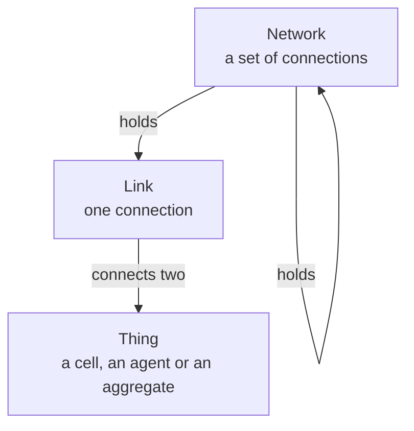
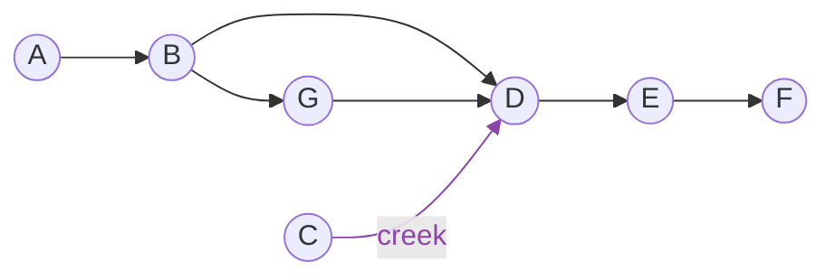
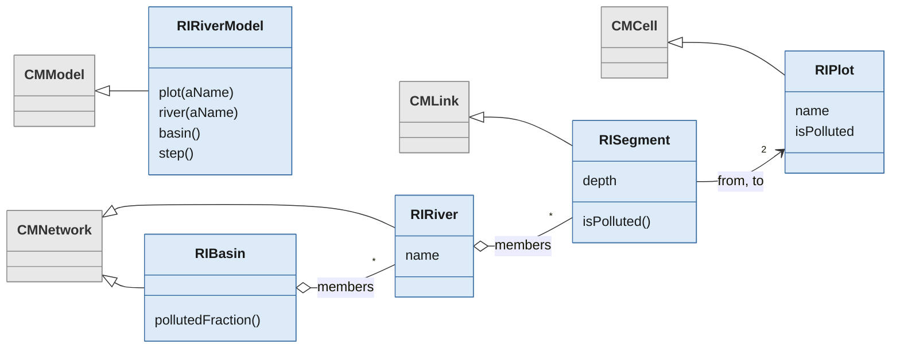

import riversImg from './img/rivers.png'
import spillImg from './img/spill.png'
import basinPointOfViewImg from './img/basinPointOfView.png'

# Networks

A **network** groups links so that you can treat them as one thing: a river made of segments, a street made of roads, or a town made of streets. A network is an entity in its own right. It has its own attributes, its own behaviour and its own points of view.

This page explains everything you can do with networks. It builds on [Links](../links/index.mdx), so read that page first.

## Things, links and networks

Cormas organizes connections in three levels, and each level refers only to the level below it:

- a **thing** is a cell, an agent or an aggregate;
- a **link** connects two things;
- a **network** holds links, and can also hold other networks.



A link connects things, and a network collects links. A link or a network is not a thing, so neither can be an end of a link, and a network cannot hold a thing directly. The things of a network are the ends of its links.

A network doesn't have to be connected. Its links can form one line, a loop, a tree, or several separate pieces. Every shape is valid.

## The example: a river basin

Every example on this page uses the River model, a small model you can load and run. To load it, open a Playground in your Cormas image and execute:

```smalltalk
Metacello new
    repository: 'github://cormas/river-model:main/src';
    baseline: 'RiverModel';
    load.
```

The basin is a grid of 30 by 30 plots. A main river flows from A to F. Between B and D, it splits around an island into two channels: a short one from B straight to D, and a longer one through G. A creek flows from C into the main river at D. Each arrow on the diagram below is a **segment**, a directed link between two plots, and the creek's segment is purple:



The main river and the creek are two networks of segments, and the basin is a network that holds both rivers. All the segments are 2 meters deep, except the short channel from B to D, which is only 0.5 meters deep.


As can be seen above, with the rivers' point of view each river shows in a color of its own, and the two channels around the island belong to the main river.

To try the examples, get a basin, its rivers and some of its plots:

```smalltalk
model := RIRiverModel exampleBasin.
main := model river: 'Main river'.
creek := model river: 'Creek'.
basin := model basin.
a := model plot: 'A'.
c := model plot: 'C'.
d := model plot: 'D'.
f := model plot: 'F'.
```

To see what a message returns, select an expression such as `basin members` and choose Print it (Ctrl+P).

The model has four classes of entities. The grey classes come from Cormas, and the blue ones belong to the model:



The init method `initSpill` pollutes plot C. At each step, pollution moves one segment downstream in the basin. Two steps after the spill, C, D and E are polluted, and the segments leaving them carry pollution, as can be seen below. Pollution never goes up the main river, so A, B and G stay clean.


## Making a network class

Each kind of network in your model is a class. Make it a subclass of `CMNetwork` in your model's package, so that Cormas finds it:

```smalltalk
CMNetwork << #RIRiver
    slots: { #name };
    package: 'River-Model'
```

Like any entity, a network class can have attributes, such as the name of a river, and methods, such as `pollutedFraction` on a basin.

## Creating and filling a network

To create a network, send `newEntity:` to your model with the network class as its argument, as for any entity. A new network is empty:

```smalltalk
river := model newEntity: RIRiver.
river links.      "an empty collection"
```

Then add links and other networks to it. Three messages do this:

| Message | Its argument | What it does |
|---|---|---|
| `add:` | A link or a network | Adds it to the network |
| `addAll:` | A collection of links and networks | Adds each of them |
| `addChainOf:through:` | A link class, then a collection of things | Creates a link of this class between each thing and the next, adds them all, and returns them |

`addChainOf:through:` is the quickest way to build a river or a street. The main river is built with two chains, one for the river and one for the channel through G:

```smalltalk
main := model newEntity: RIRiver.
main addChainOf: RISegment through: { a. b. d. e. f }.
main addChainOf: RISegment through: { b. g. d }.
```

The first chain creates the four segments A→B, B→D, D→E and E→F. The second creates B→G and G→D. Each link is directed from a thing to the next one in the collection.

The basin holds the two rivers:

```smalltalk
basin := model newEntity: RIBasin.
basin add: main.
basin add: creek.
```

Some additions are refused at once, with an error that says why:

| You try to | Result |
|---|---|
| Add a thing, as in `basin add: a` | Error: *… cannot be added to a network because only links and networks can be added* |
| Add a network to itself, directly or through the networks it holds, as in `main add: basin` | Error: *… because a network cannot contain itself* |
| Add a link or a network that is already a member | Nothing happens. It stays a member once |
| Add a link or a network that is already in another network | Allowed. It belongs to both |
| Add a link with a dead end or an end off the grid | Allowed |
| `addChainOf: RISegment through: { a }` | Creates nothing, and returns an empty collection |
| `addChainOf: RISegment through: { a. a }` | Error: *A link must connect two different entities*, as for any link |

## What a network holds

| Message | Returns | Example | Result |
|---|---|---|---|
| `members` | The links and networks added directly | `basin members` | the main river and the creek |
| `links` | All its links, including those of the networks it holds, each once | `basin links` | the 7 segments |
| `entities` | The things at the ends of its links | `main entities` | A, B, D, E, F and G |
| `includes:` | Whether a link or a network is a member, directly or through another network | `basin includes: creek links first` | `true` |

`links` returns the links in the order they were added, entering each network it holds in turn: for the basin, the 6 segments of the main river, then the creek's.

`main includes: creek links first` returns `false`: the creek's segment belongs to the creek and to the basin, but not to the main river.

## The networks a link or a network belongs to

A link or a network knows the networks it was added to. You can send these messages to both:

| Message | Returns | Example | Result |
|---|---|---|---|
| `networks` | The networks it was added to directly | `creek links first networks` | the creek |
| `networksOfClass:` | The networks it was added to directly, only those of the class it takes as its argument | `main links first networksOfClass: RIRiver` | the main river |
| `allNetworks` | Every network that holds it, directly or through other networks | `creek links first allNetworks` | the creek and the basin |

`networks` returns only direct networks. The basin holds the creek's segment through the creek, so `creek links first networks` returns the creek alone.

## Removing

| What happens | Result |
|---|---|
| You send `remove:` to a network, as in `basin remove: creek` | The creek leaves the basin. It stays in the model, with its segments |
| You send `remove:` with something that is not a direct member | Error: *… cannot be removed because it is not a direct member of …* |
| You send `delete` to a network, as in `creek delete` | The creek is removed from the model and leaves the basin. Its segments stay in the model |
| A link is deleted, or an end of it is removed from the model | It leaves every network it belongs to |
| The last link leaves a network | The network stays, empty |
| The simulation is initialized again | Networks are removed, like every other entity |

## The shape of a network

Four messages describe the shape of a network. They look only at its links, including those of the networks it holds:

| Message | Returns |
|---|---|
| `sources` | The things where no link of the network arrives, but at least one leaves |
| `sinks` | The things where no link of the network leaves, but at least one arrives |
| `terminals` | The things touched by exactly one link of the network |
| `entities` | All the things at the ends of its links |

On the basin:

| Sent to | `sources` | `sinks` | `terminals` |
|---|---|---|---|
| `main` | A | F | A and F |
| `creek` | C | D | C and D |
| `basin` | A and C | F | A, F and C |

D is a sink of the creek, because the creek's only segment arrives there. In the basin, D is neither, because the main river leaves it.

A link that is not directed counts as leaving and arriving at both its ends. So a two-way street from A to C through B has no sources and no sinks, and its terminals are A and C. A loop has no terminals. An empty network returns an empty collection for all four messages.

## Accessing links and linked entities in a network

[Links](../links/index.mdx#accessing-links-and-linked-entities) explains 24 messages that access the links of a thing and the entities linked to it. Each of them has a third version that takes a network as its argument. It follows only the links of this network, including the links of the networks it holds:

| | Either direction | Forward | Backward |
|---|---|---|---|
| **Links, one step** | `linksIn:` | `outgoingLinksIn:` | `incomingLinksIn:` |
| **Entities, one step** | `linkedEntitiesIn:` | `nextEntitiesIn:` | `previousEntitiesIn:` |
| **Links, all the way** | `allLinksIn:` | `allDownstreamLinksIn:` | `allUpstreamLinksIn:` |
| **Entities, all the way** | `allLinkedEntitiesIn:` | `allDownstreamEntitiesIn:` | `allUpstreamEntitiesIn:` |

Here they are sent to plot D with the main river as their argument:

| | Either direction | Forward | Backward |
|---|---|---|---|
| **Links, one step** | `d linksIn: main`: B→D, D→E, G→D | `d outgoingLinksIn: main`: D→E | `d incomingLinksIn: main`: B→D, G→D |
| **Entities, one step** | `d linkedEntitiesIn: main`: B, E, G | `d nextEntitiesIn: main`: E | `d previousEntitiesIn: main`: B, G |
| **Links, all the way** | `d allLinksIn: main`: the 6 segments of the main river | `d allDownstreamLinksIn: main`: D→E, E→F | `d allUpstreamLinksIn: main`: B→D, G→D, A→B, B→G |
| **Entities, all the way** | `d allLinkedEntitiesIn: main`: B, E, G, A, F | `d allDownstreamEntitiesIn: main`: E, F | `d allUpstreamEntitiesIn: main`: B, G, A |

The creek's segment arrives at D too, but none of these results include it, because it isn't in the main river.

### A network or a link class?

A link class selects links by their kind, and a network selects them by the group they belong to. All the segments of the basin are of the same class, so only a network can tell the two rivers apart:

```smalltalk
d allUpstreamEntitiesLinkedBy: RISegment.   "B, G, C and A: every segment, whichever river"
d allUpstreamEntitiesIn: main.              "B, G and A: only the main river"
d allUpstreamEntitiesIn: basin.             "B, G, C and A: both rivers"
c allDownstreamEntitiesIn: creek.           "D: the creek ends there"
c allDownstreamEntitiesIn: basin.           "D, E and F: everything a spill at C can reach"
```

:::tip
Use the messages that take a network as their argument when two groups of links of the same class meet, such as two rivers crossing at a plot, or two bus lines that share a road.
:::

The River model uses `nextEntitiesIn:` to move pollution one segment downstream:

```smalltalk
plotsToPollute addAll: (plot nextEntitiesIn: basin)
```

## Ways and distances

A **way** is the list of links to follow, in order, from a thing to another one in a network. Cormas looks for the best way when you send one of these messages to the starting thing:

| Message | Returns |
|---|---|
| `wayTo:in:` | The shortest way, counted in cells |
| `wayTo:in:cost:` | The way with the lowest total cost |
| `wayTo:in:constraint:` | The shortest way, counted in cells, through the links that satisfy the constraint |
| `distanceTo:in:` | The length of the shortest way, in cells |
| `distanceTo:in:cost:` | The total cost of the cheapest way |

Their arguments:

| Keyword | Its argument |
|---|---|
| `wayTo:` or `distanceTo:` | The thing to reach |
| `in:` | The network to search. Only its links are followed |
| `cost:` | A block that takes a link and returns its cost, a number that must not be negative |
| `constraint:` | A block that takes a link and returns `true` when the way can follow it |

Ways follow the direction of directed links, and follow undirected links both ways.

The shortest way from A to F takes the short channel from B to D:

```smalltalk
a wayTo: f in: main.          "A→B, B→D, D→E, E→F"
a distanceTo: f in: main.     "48: 14 + 17 + 7 + 10 cells"
```

A boat goes slowly in shallow water. With a cost of length divided by depth, the short channel, 17 cells long and only 0.5 meters deep, costs 34, while the longer channel through G costs 10.5. So the cheapest way goes around the island:

```smalltalk
a wayTo: f in: main cost: [ :segment | segment length / segment depth ].
    "A→B, B→G, G→D, D→E, E→F"
a distanceTo: f in: main cost: [ :segment | segment length / segment depth ].
    "26"
```

A boat that needs at least 1 meter of water can't use the short channel at all:

```smalltalk
a wayTo: f in: main constraint: [ :segment | segment depth >= 1 ].
    "A→B, B→G, G→D, D→E, E→F"
```

The network decides which links can be followed. The creek is not in the main river, so there is no way from C to F in it, but there is one in the basin:

```smalltalk
c wayTo: f in: main.          "empty"
c wayTo: f in: basin.         "C→D, D→E, E→F"
c distanceTo: f in: basin.    "39"
```

What these messages return in special cases:

| Case | `wayTo:in:` and its variants | `distanceTo:in:` and its variant |
|---|---|---|
| From a thing to itself | An empty collection | `0` |
| No way, for example against the flow, as in `f wayTo: a in: main` | An empty collection | Error: *… cannot reach …* |
| A thing that isn't in the network | An empty collection | Error: *… cannot reach …* |
| A link has an end off the grid, so it has no length, and there is no `cost:` | Error: *… has no length because … is not on the grid. Use a cost: block instead* | The same error |
| The `cost:` block returns a negative number | Error: *… has a negative cost, which is not allowed* | The same error |

When two ways are equally good, Cormas always chooses the same one.

:::tip
A distance is one number, so there is no distance when there is no way. Before you send `distanceTo:in:`, check that a way exists: `(c wayTo: f in: main) isEmpty`.
:::

A way in a network is made of links, because you travel along the links. `wayTo:` without `in:`, sent to a cell, returns the cells of a way across the grid, which is a different thing.

## Points of view

Networks are not drawn as such: each link is drawn as one line. A network decides how its links look when you select a point of view for it.

For each link, the outermost network with an **active** point of view decides. If none has one, the link uses its own point of view. A point of view is active when it has a color that isn't fully transparent, or a size. The default `pov` of a network is not active, and neither is `povInvisible`.

So in the basin:

| To see | `RIBasin` | `RIRiver` | `RISegment` |
|---|---|---|---|
| How polluted the whole basin is, as one color | `povPollution` | Anything | Anything |
| Each river in a color of its own | `pov` | `povRiver` | Anything |
| Each segment, clean or polluted | `pov` | `pov` | `pov` |


Two steps after the spill, 3 of the 7 segments carry pollution. With `povPollution` selected for the basin, every segment shows the same mix of blue and brown, as can be seen above, even though `povRiver` is also selected for the rivers.

:::caution
While a network's point of view is selected, changing the point of view of its links seems to do nothing. Select `pov` for the network to see its links again.
:::

When a link belongs to two networks at the same level, the network it joined first decides.

A point of view of a network usually summarizes its links. The basin's uses the share of polluted segments:

```smalltalk
RIBasin >> povPollution
    <pov>
    ^ CMPointOfView
        color: ((Color fromHexString: '7A4E2D')
            mixed: self pollutedFraction
            with: (Color fromHexString: '3B8ED0'))
        size: 0.35
```

## Tips and common mistakes

- **A network is not a thing.** It is not on the grid, it can't be the end of a link, and you can't send it the messages that access links: send them to its things, with the network as their argument.
- **Check for an empty network** before averaging: `(network links collect: [ :link | link wear ]) average` raises an error when there are no links.
- **Check that a way exists** before you send `distanceTo:in:`, or take `first` of a way.
- **`networks` returns direct networks only.** Use `allNetworks` to include the networks that hold them.
- **A network's point of view hides its links' points of view.** Select `pov` for the network to see them again.

## All the messages on this page

| Sent to | Messages |
|---|---|
| A network | `add:`, `addAll:`, `addChainOf:through:`, `remove:`, `delete`, `members`, `links`, `entities`, `includes:`, `sources`, `sinks`, `terminals` |
| A link or a network | `networks`, `networksOfClass:`, `allNetworks` |
| A cell, an agent or an aggregate | The 12 messages in [Accessing links and linked entities in a network](#accessing-links-and-linked-entities-in-a-network), and `wayTo:in:`, `wayTo:in:cost:`, `wayTo:in:constraint:`, `distanceTo:in:`, `distanceTo:in:cost:` |

:::info See it in a real model
The [Road Traffic model](/models/road-traffic) builds streets from roads with `addChainOf:through:`, holds them in a town, finds the cheapest way through the town with `wayTo:in:cost:`, and shows wear on roads, streets or the whole town.
:::
