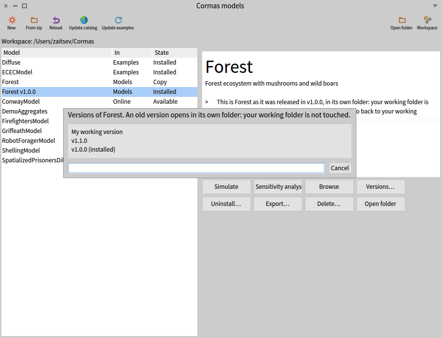
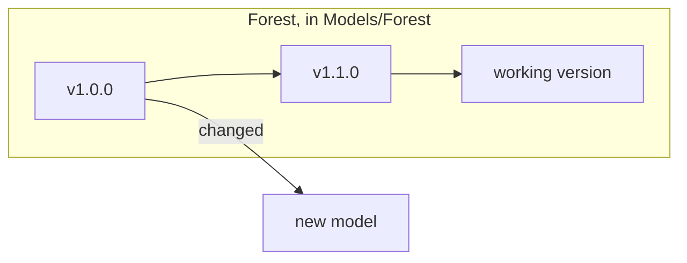

# Versions

:::warning Promises start with Cormas 1.0.0
Everything this page describes already works, and you can use it today: Cormas records which version made each model, warns before installing, and lets you choose versions of your models and of the examples.

What is not guaranteed yet is what Cormas promises with it, in **Reproducible research** below: archived releases with a DOI and checksums, and models that keep running with the Cormas they were made with. These promises start with Cormas 1.0.0, which will be released soon.
:::

This page describes the versions of Cormas, how a model records the Cormas it was made with, the versions of your own models, and the versions of examples. The folders, the model list and backups are described in [Workspace](../workspace/index.mdx).

:::tip[Reproducible research]
**A model published with a paper keeps running, exactly as it was, for many years.**

- **Every release of Cormas is archived permanently**, with its own DOI. The archive holds everything needed to run it: the Pharo virtual machine, the image, the sources, and the examples made for that release.
- **Every file of a release has a published checksum**, so anyone can check that they run exactly the files of that release.
- **A release never changes.** Everything it loads is fixed to an exact version, so installing the same release always gives the same code.
- **You never have to update.** Patch and minor updates do not break your model, and a new major is only used if you choose to migrate your model to it. A model keeps working with the Cormas it was made with.
- **Every version of a model can be cited.** With git, a version of a model is a tag of its repository. Without git, a zip of the model folder deposited in an archive such as Zenodo gets its own DOI.

To make a result reproducible, give in the paper the version of Cormas, with its DOI, and the version of the model, with its tag and repository, or its DOI. Publish results made with a release of Cormas, never with a development version.
:::

## Versions of Cormas

A version of Cormas has three numbers, `major.minor.patch`, such as `1.0.0`. Each number tells what an update means for your model:

| Update | Brings | Your model |
|---|---|---|
| patch, such as `1.0.0` to `1.0.1` | Bug fixes | Keeps working, unchanged. |
| minor, such as `1.0.0` to `1.1.0` | New features | Keeps working, unchanged. |
| major, such as `1.2.0` to `2.0.0` | Changes that can break models | Must be migrated: changed to work with the new major, as described in the migration guide of that major (see [Moving a model to another major](#moving-a-model-to-another-major)). |

**Cormas never updates itself.** An image of Cormas stays at the version it was installed with, for as long as you use it. A newer version of Cormas is a new image, which you install yourself, when you choose to.

You do not have to move to a new major: a model keeps working with the Cormas it was made with (see Reproducible research, above).

The development version of Cormas ends with `-dev`, such as `1.0.0-dev`.

The **line** of a version is its major, such as `1` for every `1.x.y`, or `dev` for a development version. Each line has its own list of examples in the catalog.

To get the version of Cormas in an image, print this in a Playground:

```smalltalk
CMVersion current
```

## The Cormas a model is made with

The `cormas` field of `cormas.json` says which Cormas the model was last saved with: its line and minor, such as `"1.0"`. Do not change it by hand.

Since Cormas never updates itself, the Cormas a model is made with changes only when you choose to open the model in a newer Cormas, and change its code there. Opening, installing or running a model with a newer Cormas never changes it. The field changes only when a change to the code of the model is saved:

| The model was made with | You change its code with | Then |
|---|---|---|
| Cormas 1.0 | Cormas 1.0 | The field stays `1.0`. |
| Cormas 1.0 | Cormas 1.2, a newer minor | The field becomes `1.2`, without asking: the model keeps working, since minors do not break models. |
| Cormas 1.2 | Cormas 2.0, another major | Cormas asks whether to migrate the model, and changes nothing unless you accept (see [Moving a model to another major](#moving-a-model-to-another-major)). |

- A model saved with a development version says `"1.0-dev"`. It counts as `1.0`, and becomes `1.0` at the first change saved with a release of Cormas 1.
- A model without the field gets it at the first change saved.

### The installation warning

Cormas `X.Y` installs a model silently when the model was made with Cormas `X.Z`, where `Z` is not greater than `Y`, or when the catalog lists the exact version of its folder as checked with this Cormas.

For example, Cormas 1.2 installs a model made with Cormas 1.0 or 1.2 silently, but warns before installing a model made with Cormas 1.3, 2.0 or 0.9.

When it warns, it says that the model has not been checked with this Cormas and may not work, with two choices:

- **Install anyway**: installs the model.
- **Cancel**: installs nothing.

The warning is shown by **Install**, **Download and install**, **From zip** and **Versions…**.

### Moving a model to another major

A model made with another major of Cormas, older or newer, cannot be changed without moving it to this major. The first change to its code asks, with two choices:

- **Migrate to 1.0**: Cormas backs up the folder, as `Forest (Cormas 0.9) <date> <time>.zip` in `Backups`, then saves the change and records `"1.0"` in `cormas.json`. The model may no longer work with Cormas 0.9.
- **Don't save**, or closing the dialog: the change is undone, and the folder is not touched. The model stays a Cormas 0.9 model, which cannot be changed with this Cormas.

## Versions of your models

Git is a tool that records the history of a folder, change after change. A **tag** is a name given to one moment of that history, such as `v1.0.0`. With git, the versions of a model are the tags of its folder. You make tags with git, and choose their names (see [Git](../workspace/index.mdx#git)). A model whose folder is not a git repository has no versions.

A model then has two kinds of versions:

- its **working version**: the folder you work in, in `Models`, where every change is saved. It is the latest version of the model;
- its **old versions**: one for each tag. An old version is the model exactly as it was when it was tagged. It never changes, so that anyone who uses that version gets the same model.

### Choosing a version {#versions-dialog}

When the folder of your model has tags, the model list shows a **Versions…** button for the model. It opens the list of its versions:

- **My working version**;
- then each tag, newest first.

The version installed in the image is marked "(installed)".



Choosing a tag installs that old version in place of the installed one, which is first uninstalled and backed up:

- The first time, Cormas copies the model, as it was at that tag, into its own folder of `Models`, such as `Forest v1.0.0`. Later, it reuses that folder, with the files written there, such as outputs.
- The copy is made from the history recorded by git: changes that were not committed are not part of any version.
- Your working folder is never touched.

An old version is shown in the model list as "Forest v1.0.0". It has the name the model had when it was tagged, even if the model was renamed since. It also has the **Versions…** button, to choose another version, or **My working version** to go back.

### Changing an old version

Changing an old version would start a branch of the model: a second line of development, beside your working version. To keep things simple, Cormas does not manage branches. A model started from an old version becomes a **new, independent model**, in its own folder, such as `Models/Forest v1.0.0 copy`, without the history of the original:



The new model is a copy of the old version: it has the same name, packages and classes as Forest, so only one of the two can be installed at a time (see [Copies of a model](../workspace/index.mdx#copies-of-a-model)).

A change to the code of an old version asks what to do, with three choices:

| Choice | What it does |
|---|---|
| **Go back to my working version of Forest** | Undoes the change, installs the working version, and shows what was being changed, as it is in the working version, in the same browser. This is the first choice. |
| **Make a new model from v1.0.0…** | After a second confirmation, copies the old version, without git, to `Models/Forest v1.0.0 copy`, and saves the change there. This is the new model described above. |
| **Stay on v1.0.0 (read-only)** | Undoes the change. Closing the dialog does the same. |

## Versions of examples

The catalog lists, for each line, the versions of each example and the Cormas each one was made with.

**Download** gets, for Cormas `X.Y`, the newest version of the example listed for line `X` that is made with a Cormas no newer than `X.Y`. Cormas 1.0 never gets a version made with Cormas 1.1.

**Update examples** brings every downloaded example to the version this Cormas offers, except pinned examples (see below).

### Choosing a version of an example

**Versions…** is shown on an example when the catalog offers several versions of it to this Cormas. It is never shown in a development version of Cormas. It lists each version with the Cormas it was made with, such as "v1, made with Cormas 1.0". The version this Cormas offers is marked "(recommended)", and the one in the folder "(current)".

Choosing a version puts it in the folder of the example, after backing up the files that were changed by hand, and reloads the example if it is installed.

An example at a version other than the recommended one is **pinned**:

- **Update examples** does not change it.
- Its description in the model list says which version it is at, and which one is recommended.

Choosing the recommended version in **Versions…** unpins it.
