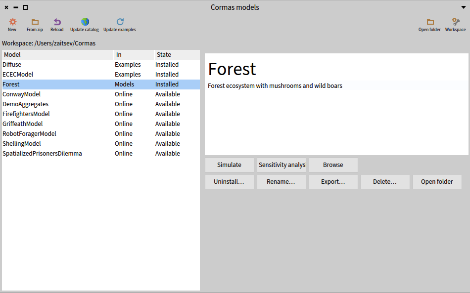

# Workspace

The **workspace** is the folder on your computer that holds your Cormas models. Each model is a folder of the workspace, and that folder holds everything about the model: its code, its data, its screenshot and the files exported from its simulations. Cormas keeps each model folder up to date with the code in the image, so a model folder can be opened, zipped, emailed or put under version control at any moment.

This page describes the workspace, model folders, the model list, examples, exports and backups. The versions of Cormas and of models are described in [Versions](../versions/index.mdx).

## The workspace folder

A workspace holds four folders. Cormas creates `Examples`, `Catalog` and `Backups` when it first needs them.

| Folder | What it holds | Who changes it |
|---|---|---|
| `Models` | Your models | You |
| `Examples` | The example models you downloaded | Cormas only |
| `Catalog` | A copy of the catalog of example models, to browse it without internet (see [The catalog](#the-catalog)) | Cormas only |
| `Backups` | The zips Cormas makes before removing any code (see [Backups](#backups)) | Cormas only |

Only the folders directly inside `Models` and `Examples` can be models.

### Choosing a workspace

The default workspace is `~/Cormas` (`C:\Users\<name>\Cormas` on Windows). An image without a workspace asks for one when it starts, and offers three choices:

| Choice | What it does |
|---|---|
| **Use ~/Cormas**, or **Create ~/Cormas** | Uses the default workspace if `~/Cormas` holds one, otherwise creates it there. This is the first choice. |
| **Choose an existing workspace…** | Uses a workspace in a folder you choose. |
| **Create a new workspace…** | Creates a workspace in a folder you choose. |

Cancelling chooses nothing, and the next start asks again. A folder that does not hold a workspace, or where Cormas cannot write, is refused with the reason, and the question is asked again. **Change working directory…** offers the same choices.

The default is not the Documents folder, because Documents is often synchronized with iCloud or OneDrive, which can remove files from the computer to save space.

### Several workspaces

You can have several workspaces, for example one for research and one for teaching. An image uses one workspace at a time and remembers it.

**Change working directory…**, in the Cormas menu (or **Workspace** in the toolbar of the model list), makes the image use another workspace. Every installed model is uninstalled, after being backed up. It is refused while a model is Not saved.

## A model folder

A model folder looks like this:

```
Forest/
  cormas.json      the name of the model, a summary, and the Cormas it was made with
  README.md        the documentation of the model
  screenshot.png   a picture of the model
  src/             the code of the model
  data/            the files the model reads
  output/          the files exported from simulations
  .gitignore       tells git to ignore output/
  .project         tells Iceberg where the code is
  .git/            only if the folder is a git repository
```

| File or folder | Description |
|---|---|
| `cormas.json` | Makes the folder a model (see [cormas.json](#cormasjson)). |
| `README.md` | Shown in the model list when the model is selected. |
| `screenshot.png` | Shown in the model list and in the catalog. Any size and shape. You make it yourself; until then, the list shows a placeholder. |
| `src/` | The code: the packages of the model, in Tonel format, including its baseline (`BaselineOfForest`). |
| `data/` | The files the model reads, such as maps or parameters. |
| `output/` | The images and data exported from simulations (see [Exports](#exports)). |

### cormas.json

The `cormas.json` file of the Forest model looks like this:

```json
{
	"baseline" : "Forest",
	"summary" : "Trees grow, burn and grow back on a grid of cells.",
	"cormas" : "1.0"
}
```

| Field | Content |
|---|---|
| `baseline` | The name of the model: the name of its baseline, without `BaselineOf`. The model Forest is loaded by the class `BaselineOfForest`, in `src/`. Do not change it by hand, or the model can no longer be loaded: rename the model with **Rename…** (see [Renaming a model](#renaming-a-model)). |
| `summary` | One paragraph describing the model, shown in the model list when the model has no README, and in the catalog. |
| `cormas` | The version of Cormas the model was last saved with, such as `1.0`. Cormas writes it; do not change it by hand (see [Versions](../versions/index.mdx#the-cormas-a-model-is-made-with)). |

### The name of a model

The name of a model is its baseline, written in `cormas.json`, not the name of its folder. Renaming the folder does not change the model.

:::note What is a baseline?
A **baseline** is a class that describes how to load a Pharo project: which packages it is made of, in which order to load them, and which other projects they need. Its name starts with `BaselineOf`, followed by the name of the project, such as `BaselineOfForest`. Pharo loads a project by reading its baseline. Readers who know VisualWorks can think of it as a bundle definition.

Cormas uses the baseline as the name of a model because the baseline is what loads the model into the image. Two models with the same baseline would load the same packages, so only one of them can be loaded at a time. The name of a folder, on the other hand, can be changed at any time without changing the model.

Cormas creates the baseline of a new model, and keeps it up to date (see [The baseline](#the-baseline)).
:::

The name of a model is also shown in the title of its simulation and sensitivity analysis windows.

### Copies of a model

A copy of a model folder holds the same model: the same name, the same packages and the same classes. Only one of the two can be installed at a time: the other one is shown as Copy in the model list.

To install both side by side, the copy needs its own name and its own code. Uninstall the original, install the copy, give it a new name with **Rename…** (see [Renaming a model](#renaming-a-model)), then rename its packages and classes in the Pharo tools. Until then, Cormas refuses to install a model whose packages or classes are already in the image.

:::info
In the future, Cormas will be able to give a copy its own name, packages and classes in one step.
:::

### Renaming a model

**Rename…**, in the model list, renames an installed model of `Models`:

- its baseline and the package of the baseline, such as `BaselineOfForest` to `BaselineOfWoodland`;
- the `baseline` field of `cormas.json`;
- its folder, when the folder has the name of the model and the new name is free.

The other packages and classes of the model keep their names (see [Copies of a model](#copies-of-a-model)). The new name is made of letters, digits and `_`, and no other model of the workspace, and no class of the image, may have it.

Renaming the baseline, or its package, in a Pharo tool is renaming the model: Cormas asks whether to rename the model, and otherwise gives the baseline its name back.

Renaming the baseline of an example is a change like any other: it makes the example yours, and Cormas offers to make your own copy, which is then renamed (see [Changing an example](#changing-an-example)). An old version keeps the name the model had when it was tagged (see [Changing an old version](../versions/index.mdx#changing-an-old-version)).

If the folder of the model was open in GitHub Desktop, locate it again there after it was renamed.

### The code of a model

The packages of a model are exactly those its baseline declares. Cormas saves only those in the folder:

- A loaded package named like the packages of the model but not declared in its baseline is never saved. The model list shows it, with a button **Add &lt;package&gt;** that adds it to the model.
- Changes to the classes of Cormas itself are never saved in a model folder.

Every change to the code of an installed model is written to its folder at once, from any tool: a method or a class added, changed, removed or renamed. A package renamed or removed is renamed or removed in the folder too, when Cormas manages the baseline.

Package and class names can be anything Pharo accepts: Cormas imposes no naming rule. A new model suggests names, such as `Forest-Model` and a prefix for its classes, which you can change at any time.

### The baseline

Cormas manages the baseline of a model it created. When a package of the model is added with **Add &lt;package&gt;**, renamed or removed, Cormas updates the baseline, so you never need to edit it.

You can also write the baseline yourself, for example to depend on other projects or to define groups of packages. The first time you change a baseline that Cormas manages, Cormas asks whether you want to manage it yourself:

- **Manage it myself**: Cormas never changes the baseline again. Its method `isManagedByCormas` now returns `false`. When you add, rename or remove a package, update the baseline yourself.
- **Cancel**: the change is undone.

A baseline without `isManagedByCormas`, such as those of the examples, is managed by its authors. **Add &lt;package&gt;** then explains how to add the package to the baseline by hand.

### Reaching the files of a model

`folder`, sent to a model or to its class, returns the folder of the model. To get a file, add its path:

```smalltalk
self folder / 'data' / 'map.csv'
```

`folder` raises an error for a model that was not installed from the workspace.

## The model list

Choose Cormas > **Models** to open the model list. It shows the models of the workspace and the examples of the catalog, one row per folder. Installed models come first, then `Models`, `Examples`, and the examples available online.

For example, in the workspace `/Users/zaitsev/Cormas`, the model Forest of `Models` and the examples Diffuse and ECECModel are installed, and the other examples of the catalog are available online. When Forest is selected, the model list shows its README and the buttons of an installed model of `Models`, as can be seen below.



### Columns

| Column | Content |
|---|---|
| Model | The name of the model, or its name and version for an old version, such as "Forest v1.0.0" (see [Versions of your models](../versions/index.mdx#versions-of-your-models)). |
| In | **Models** or **Examples**: the folder the row comes from. **Online**: only in the catalog. **Image**: installed, but its folder is gone. |
| State | See below. |

### States

| State | Meaning |
|---|---|
| Available | An example in the online catalog, not downloaded. |
| Not installed | A model of the workspace, not loaded in this image. |
| Installed | Loaded from this folder. The image and the folder are identical. |
| Not saved | Loaded, but Cormas stopped saving it to its folder. The description says why. |
| Copy | The same model is installed from another folder. |
| Not a model | A folder without a readable `cormas.json`. |

When a row is selected, the description shows its README (or its summary from the catalog), followed by what to know about its state.

### Toolbar

| Button | What it does |
|---|---|
| **New** | Creates a model (see [New model](#new-model)). |
| **From zip** | Unzips a model into a new folder of `Models`, then installs it. A zip holding the model folder one level down is accepted. |
| **Reload** | Reloads the installed models from their folders, for changes made outside Cormas. |
| **Update catalog** | Downloads the list of examples and their screenshots. |
| **Update examples** | Brings every downloaded example to the version the catalog offers (see [Examples](#examples)). |
| **Workspace** | Makes the image use another workspace, as **Change working directory…** does. |
| **Open folder** | Opens the workspace folder. |

### Buttons of the selected row

| Button | Shown for | What it does |
|---|---|---|
| **Download** | Available | Downloads the example into `Examples`. |
| **Download and install** | Available | Downloads the example, then installs it. |
| **Install** | Not installed | Loads the model into the image from its folder. Refused, with the reason, when a package or a class of the model is already in the image. |
| **Simulate** | Installed, Not saved | Opens a simulation of the model. |
| **Sensitivity analysis** | Installed, Not saved | Opens a sensitivity analysis of the model. |
| **Browse** | Installed, Not saved | Opens the code of the model in a System Browser. |
| **Reload from folder** | Not saved | Backs up the code in the image, then loads the model from its folder. |
| **Add &lt;package&gt;** | A model with a package not declared in its baseline | Adds the package to the model, so that it is saved. |
| **Versions…** | A model of `Models` with git tags, an old version, or an example with several versions | Chooses the version of the model (see [Choosing a version](../versions/index.mdx#versions-dialog) and [Versions of examples](../versions/index.mdx#versions-of-examples)). |
| **Uninstall…** | Installed, Not saved | Backs up the code of the model, then removes it from the image. The folder stays as it is. |
| **Rename…** | Installed, in `Models` | Renames the model (see [Renaming a model](#renaming-a-model)). |
| **Export…** | A model with a folder | Zips the whole model folder, as it is on disk, to a file you choose. |
| **Delete…** | A row with a folder | Backs up the folder, uninstalls the model if it is installed, then deletes the folder. |
| **Open folder** | A row with a folder | Opens the folder. |
| **Restore folder** | In = Image | Writes the code of the model, as it is in the image, into a new folder of `Models`. Only the code is restored: the README, data and outputs were in the folder that is gone. |

## New model

**New** in the model list, or Cormas > **New model**, creates a model. It takes:

- a name, such as `Forest fire`. The name of the model, its baseline, is made from it in one word: `ForestFire`;
- a prefix for the names of its classes, suggested from the name;
- a short description, which becomes the summary.

Before it creates anything, the dialog shows what will be created, or why it cannot be. It creates `Models/ForestFire` with `cormas.json`, `README.md`, `.gitignore`, `.project`, `data/`, `output/` and `src/`. `src/` holds the baseline, a package with a model class and a cell class, and a test package with a test class. Then it installs the model. The new folder is not a git repository.

## Examples

Examples are models made by the Cormas team, ready to install, simulate and study.

### The catalog

The **catalog** is the list of the example models: their names, summaries and screenshots. Its online version is kept by the Cormas team on GitHub. Cormas keeps a copy of it in the `Catalog` folder of the workspace:

- **Browsing the catalog works without internet.** The model list shows the examples of the catalog, with their summaries and screenshots, from that copy.
- **Downloading an example needs internet.** The catalog only lists the examples: their code is downloaded when you ask for it.
- **Update catalog** synchronizes the copy with the online catalog, so that new examples and new versions appear. Nothing changes until you press it.

### Downloaded examples

**Download** puts an example in `Examples/<name>`, at the version the catalog offers for this version of Cormas (see [Versions of examples](../versions/index.mdx#versions-of-examples)). A downloaded example stays there until you delete it, with **Delete…**. It can be installed and used without internet, from any Cormas image that uses this workspace.

**Update examples** brings every downloaded example to the version the catalog now offers. Before updating an example, Cormas backs up any of its files that were changed. Files added to the example folder, such as outputs, are kept.

### Changing an example

Feel free to change an example: it is the best way to learn how it works. Changing it makes it **yours**. At the first change, Cormas offers to make your own copy of the example in `Models`, and the original example stays in `Examples`, as it was:

- **Yes**: Cormas copies the example folder, its git history included, to `Models` (as `Firefighters`, or `Firefighters 2` if that name is taken), uses your copy from then on, and saves the change there. Play with it as much as you like: it is a model of yours, like any other.
- **No**: the change is undone, and the example stays as it was.

The original stays in `Examples` so that it can be updated by the Cormas team, and installed again at any time, exactly as they made it.

To share your changes with the Cormas team, so that they become part of the example:

- with git and GitHub, open a pull request on the repository of the example: your copy is a clone of it, with its history;
- without git, zip the folder of your copy with **Export…**, and send it to us by email (see [Community](../../community/index.md)). The git history inside the zip shows us what you changed.

## Exports

**Save to PNG** (on the space and on charts) and **Save to CSV** (on the data of a simulation or a sensitivity analysis) write the file into the `output` folder of the model, with no dialog. The name of the file says what it holds and when it was made:

- `space 2026-11-07 14-05-09.png`
- `chart 2026-11-07 14-05-09.png`
- `data 2026-11-07 14-05-09.csv`

Exporting never replaces a file: a second export within the same second is named `data 2026-11-07 14-05-09 2.csv`. A message shows where the file is; clicking it opens the folder.

A model that was not installed from the workspace has no `output` folder, so Cormas asks where to save the file.

## Backups

Before Cormas removes or replaces any code, it zips it into `Backups`. This happens when a model is reloaded from its folder, uninstalled, deleted, migrated to a new version of Cormas, or switched to another of its versions, when an example is updated, when a change is undone, and when the image changes to another workspace.

The name of a backup says what it holds and when it was made:

| Name | Content |
|---|---|
| `Forest 2026-11-07 14-05-09.zip` | The model folder |
| `Forest (code in the image) 2026-11-07 14-05-09.zip` | The code of the model as it was in the image |
| `Forest (Cormas 0.9) 2026-11-07 14-05-09.zip` | The model folder before it was migrated from Cormas 0.9 (see [Moving a model to another major](../versions/index.mdx#moving-a-model-to-another-major)) |

A backup never replaces another one: a second backup within the same second ends with ` 2`. Cormas never deletes backups.

A backup has the layout of a model folder. To restore it, unzip it into `Models`.

## Git

A model folder is a normal git project, and git is never required. Cormas never runs git commands, and never creates repositories, branches, commits or tags. The versions of a model are its git tags (see [Versions of your models](../versions/index.mdx#versions-of-your-models)).

When the folder of an installed model is a git repository, Cormas registers it with Iceberg, the git tool of Pharo, when the model list opens or when **Reload** is pressed. Commits can then be made from the image. After a git operation made in Iceberg, Cormas reloads the model from its folder. After a git operation made outside the image, such as a pull, press **Reload**.

The `output` folder is ignored by git, but it is part of an exported zip.
