# Robot-Forager Tutorial

In this tutorial, you will learn how to build a simple agent-based model in Cormas.

## General presentation

This model is inspired by a paper by [Steels (1989)](https://citeseerx.ist.psu.edu/document?repid=rep1&type=pdf&doi=3d79478898cb3c67b6a66675577334bd5286ec01), in which a group of robots explores a distant planet to collect precious minerals and transport them to a central vehicle.

The locations of the minerals are initially unknown, but they tend to form clusters. Since communication with Earth is slow and unreliable, robots must operate autonomously. Using multiple robots allows the exploration of larger areas and improves fault tolerance, as the loss of one robot does not compromise the mission.

The central question explored in the paper is **how autonomous robots can cooperate to locate, collect, and transport minerals efficiently**. Similar challenges arise in applications such as toxic waste cleanup and garbage collection.

**Reference:** Steels, Luc. 1989. Cooperation Between Distributed Agents Through Self-Organisation. Pages 175–196 of : Demazeau, Yves, & Müller, Jean-Pierre (eds), Decentralized A.I. : Proceedings of the First European Workshop on Modelling Autonomous Agents in a Multi-Agent World (MAAMAW-89), Cambridge, England, August. Amsterdam, North-Holland : Elsevier Science Publishers.
This paper is available [here](https://citeseerx.ist.psu.edu/document?repid=rep1&type=pdf&doi=3d79478898cb3c67b6a66675577334bd5286ec01). 

## Model Description

For this tutorial, we use a simplified version of the original model: there is no central collection base, robots have unlimited carrying capacity, and they do not leave marks when collecting minerals.

The model consists of four classes:

- **RFModel** manages the simulation, including the spatial grid, robots, and minerals. It defines the grid dimensions and the initial numbers of robots and minerals.
- **RFCell** represents a cell in the spatial grid. It provides methods to check whether a mineral is present and retrieve it.
- **RFMineral** represents a mineral that can be collected by a robot.
- **RFRobot** represents an autonomous agent that moves between cells and collects minerals. Each robot maintains a collection of the minerals it has collected.

The following UML class diagram illustrates the model's structure:

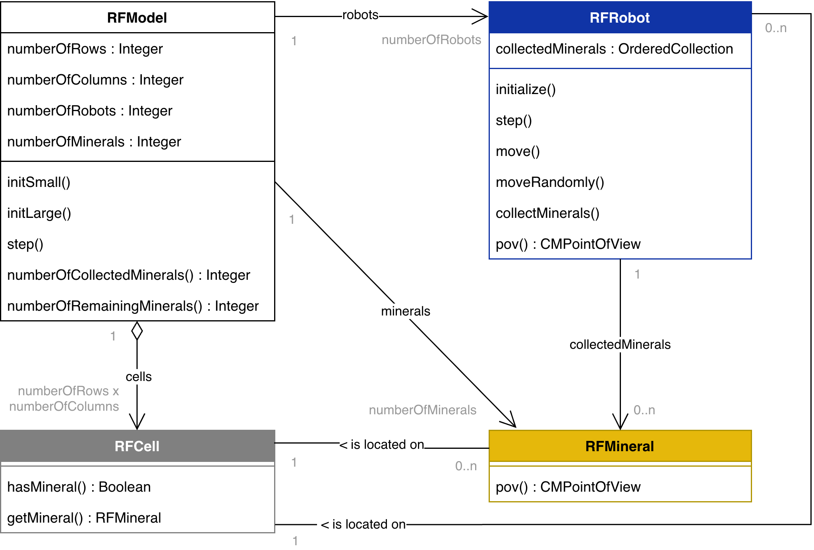 

### Simulation Rules

The simulation follows several rules:

- Each cell can contain at most one robot and one mineral.
- During initialization, robots are placed first, followed by minerals. Minerals cannot be placed on cells already occupied by robots.
- When a robot collects a mineral, the mineral is removed from its cell and added to the robot's collection.

### Robot Behavior

At each simulation step, every robot examines its eight neighboring cells and follows these rules:

1. **If a mineral is found:** Move to the cell containing the mineral and collect it.
2. **Otherwise:** Move randomly to one of the eight neighboring cells.

The following activity diagram illustrates this behavior:

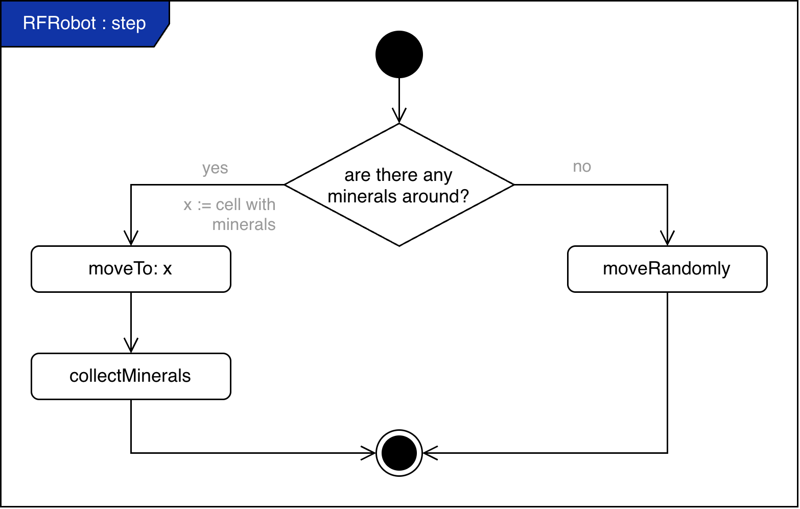

Robots act asynchronously, meaning that each robot completes its actions before the next robot acts. This prevents multiple robots from simultaneously targeting the same mineral.

### Simulation Environments

We will implement two configurations:

| Environment | Grid Size | Number of robots | Number of minerals |
|---|---|---|---|
| Small | 5x5 | 2 | 20 |
| Large | 27x27 | 10 | 200 |

Here is an example of the simulation environment:

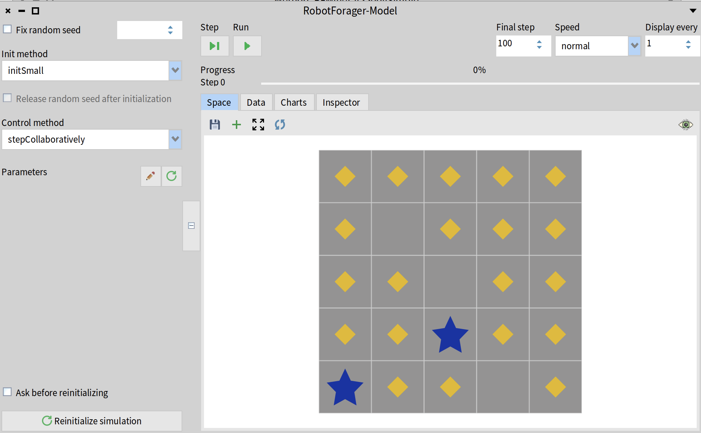

The complete implementation is available in the [robot-forager-model](https://github.com/cormas/robot-forager-model/tree/main/src/RobotForager-Model) repository.

## Step 1. Create a new model 

If you haven't donne so already, you can [Install Cormas](/download) then open a Cormas image. Click on _"Cormas"_ menu in the top left corner and select _"New Model"_.

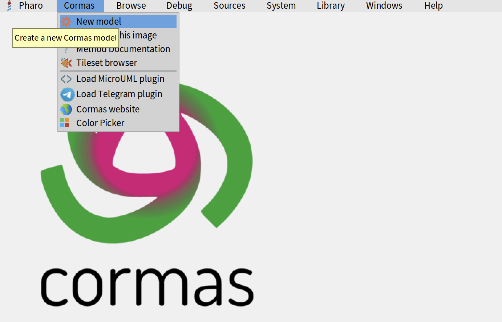

Enter _"Robot forager"_ as the model name.

In Pharo, all classes share the same namespace, so each class must have a unique name. To avoid naming conflicts, we use a project-specific prefix. Cormas automatically suggests:

- **Class prefix:** `RF` (you can change it).
- **Model class name:** `RFModel` (prefix + `Model`).

At the bottom of the window, you can preview the packages and classes that will be generated. By default, Cormas also creates:

- A **cell class** (`RFCell`) representing the cells of the spatial grid.
- A **test class** for writing unit tests.
- A **Baseline class** that defines the project's packages and dependencies, allowing it to be loaded into another Pharo image.

Finally, add a short description of your model using [Microdown](https://github.com/pillar-markup/Microdown), Markdown, or plain text.

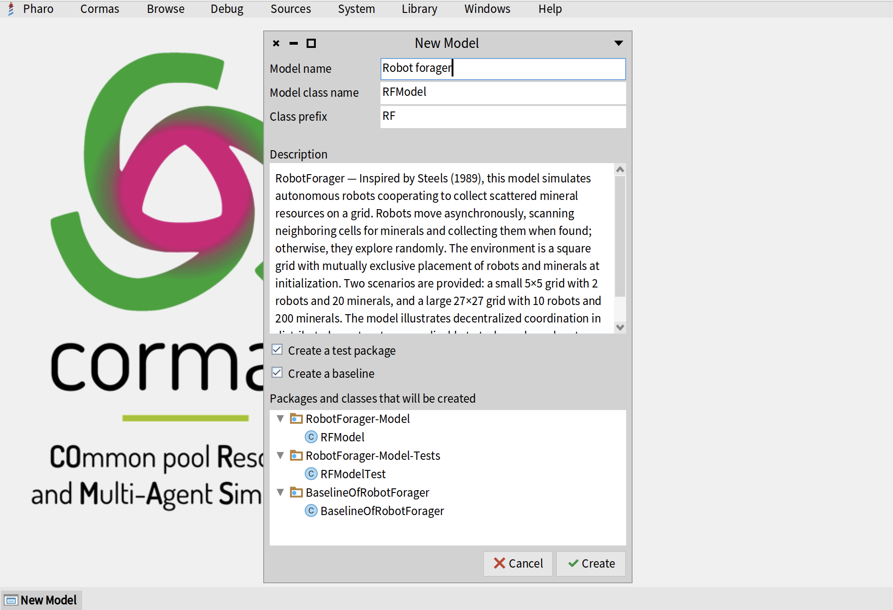

Click _"Create"_ to generate the following packages and classes:

- `RobotForager-Model` containing `RFModel` and `RFCell`
- `RobotForager-Model-Tests` containing `RFModelTest`
- `BaselineOfRobotForager` containing a class of the same name

Cormas will then open the **System Browser** on the newly created `RFModel` class.

We are now ready to start coding!

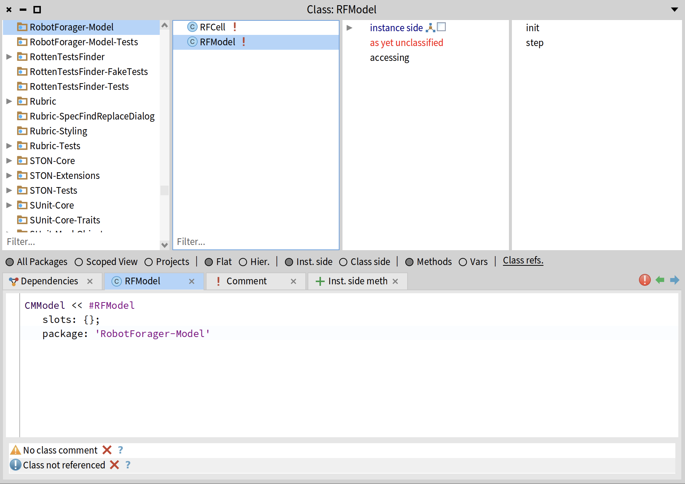


## Step 2. Create a grid

Now we are ready to create a spatial grid and take our first look at the simulation.

Every Cormas model requires at least two methods:

- **Initialization method** (`<init>`): Defines the initial state of the simulation. Executed once when the simulation starts.
- **Control method** (`<control>`): Defines what happens at each simulation step.

Cormas automatically generates templates for both methods when creating a new model.

### Default methods

The generated `init` method creates a 4 x 4 grid with eight neighbors per cell and an open (toroidal) environment. It also contains commented-out examples of creating and positioning agents.

```smalltalk title="RFModel"
init
    <init>
    "This method is used to define the initial environment of a simulation. It will be executed once when the simulation is initialized."
	
    "Example of a 4x4 rectangular grid"
    self
        createGridNumberOfRows: 4
        numberOfColumns: 4
        neighbourhood: 8
        closed: false.
		
    "Example of creating agents and randomly positioning them on a grid"
		
    "self create: 3 randomlyLocatedAloneEntitiesOfClass: YourAgentClass1.
    self create: 3 randomlyLocatedAloneEntitiesOfClass: YourAgentClass2."
```

The generated step method is initially empty. We will use it later to define the behavior of our simulation.

```smalltalk title="RFModel"
step
    <control>
    "This method will be executed at every step of the simulation"
```

Notice the **pragmas** `<init>` and `<control>`. They tell Cormas which methods can be used to initialize and control the simulation.

### Create the small environment

As described earlier, we will implement two environments: a small 5 x 5 grid and a large 27 x 27 grid. Let's start with the small one.

In the `RFModel` class, create a new method called `initSmall`:

```smalltalk title="RFModel"
initSmall
    <init>
    self
        createGridNumberOfRows: 5
        numberOfColumns: 5
        neighbourhood: 8
        closed: true.
```

The `createGridNumberOfRows:numberOfColumns:neighbourhood:closed:` method is inherited from the superclass. Its parameters define:

- **Rows and columns**: The grid dimensions (5 x 5).
- **Neighbourhood**: The shape of the cells and their neighborhood configuration:

| Value | Cell shape | Neighbors |
|---|---|---|
| `#four` or `4` | Square | 4 (orthogonal) |
| `#eight` or `8` | Square | 8 (including diagonals) |
| `#three` or `3` | Triangle | 3 |
| `#pointy6` or `6` | Pointy-top hexagon | 6 |
| `#flat6` | Flat-top hexagon | 6 |

- **Closed**: Whether the grid has boundaries:
	- `true`: Agents cannot cross the grid boundaries.
	- `false`: The grid wraps around, so agents leaving one edge reappear on the opposite side.

Finally, keep the generated step method empty for now:

```smalltalk title="RFModel"
step
    <control>
    "do nothing"
```

We now have everything needed to initialize our first spatial grid. We will add agents and their behavior in the following steps.

## Step 3. First Look at the Simulation

Now that we have created our spatial grid, let's open the simulation and explore the Cormas interface.

### Open the Simulation

From the _"Cormas"_ menu, select _"Models in this image"_.

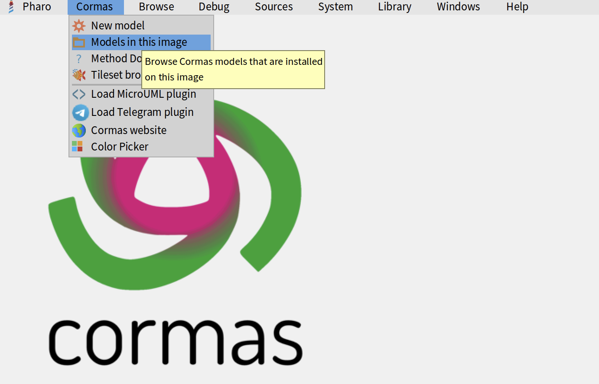

In the window that opens, select _"Robot Forager"_ from the list of installed models and click _"Simulate"_.

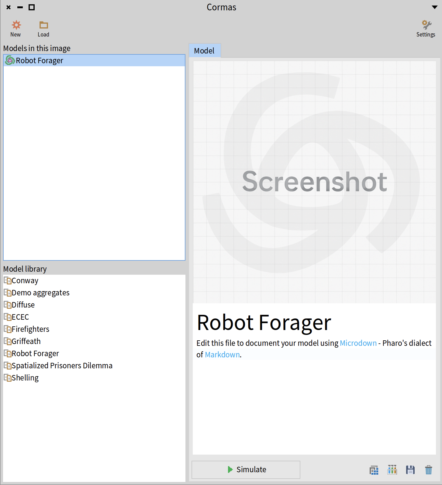

This opens the **Cormas Simulation Browser**, where you can configure and run your simulation.

The left panel lets you select the initialization (`<init>`) and control (`<control>`) methods, configure the random seed, and adjust model parameters. The right panel is initially empty because the simulation has not yet been initialized.

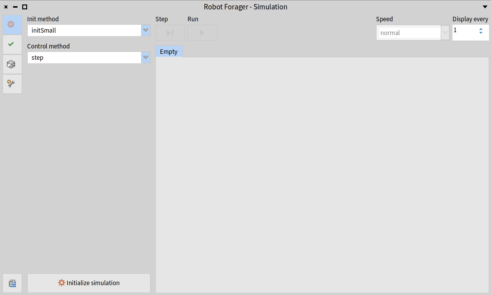

### Initialize and Run the Simulation

Our model currently has one initialization method, `initSmall`, and one control method, `step`. Both are selected by default.

Click _"Initialize simulation"_. You should see the 5 x 5 grid created by `initSmall`, containing 25 instances of `RFCell`. All cells are gray, which is the default color in Cormas.

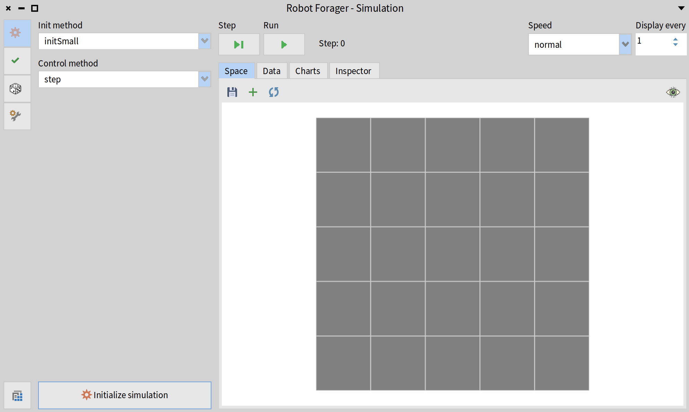

Try clicking _"Step"_ at the top of the window. This executes the selected control method (`step`) once. Since our method is empty, nothing changes in the grid, but the simulation step counter increases.

### Inspect Live Objects

One of the advantages of Cormas is that you can inspect and interact with simulation objects while the model is running.

**Inspect a cell:** Right-click any cell in the grid and select _"Inspect"_. This opens an interactive Pharo inspector for that `RFCell` instance.

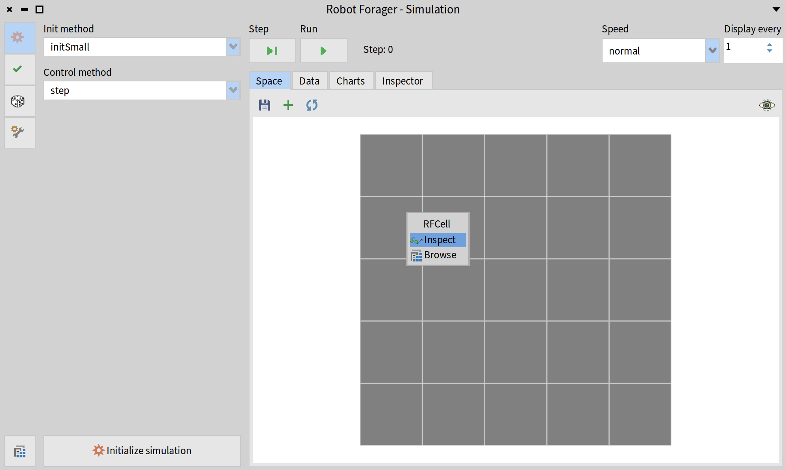

**Inspect the model:** Select the _"Inspector"_ tab in the Simulation Browser. This opens an inspector for the simulation object (`CMSimulation`).

From there, you can navigate through the live objects:

- Select `cormasModel` to inspect the `RFModel` instance.
- Explore its `spaceModel` and `entities` variables to examine the spatial environment and its cells.

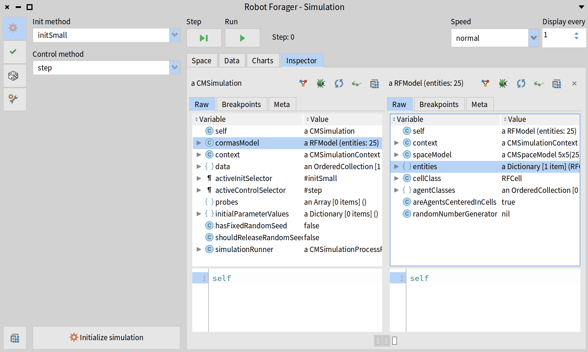

You now have a working spatial grid and can explore its objects directly. In the next steps, we will add minerals and robots to bring the simulation to life.

## Step 4. Add robots

Now let's add our first agents to the simulation. We will create a new class, define how robots should look, and place two robots on the grid.

### Create the Robot Class

Open the **System Browser** and select the `RobotForager-Model` package.

To create a new class:

1. Right-click an existing class (e.g., `RFModel`) and select _"New class"_.
2. In the class definition editor, enter the following code:

```smalltalk
CMAgent << #RFRobot
    slots: {};
    package: 'RobotForager-Model'
```

3. Press **Ctrl+S** (or **Cmd+S** on macOS) to save and compile the class.

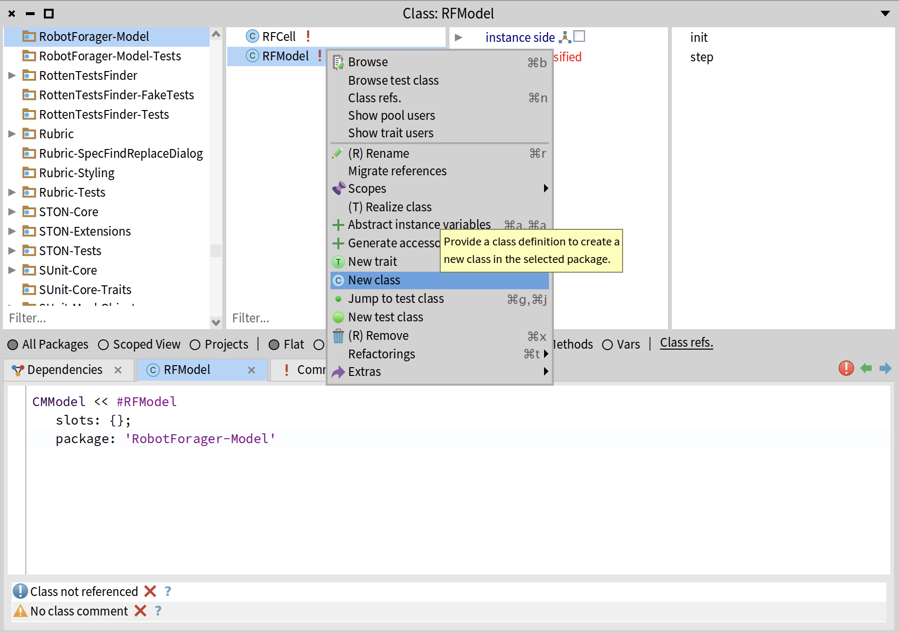 

This creates RFRobot as a subclass of CMAgent, the base class for Cormas agents. The new class belongs to the same package as our model.

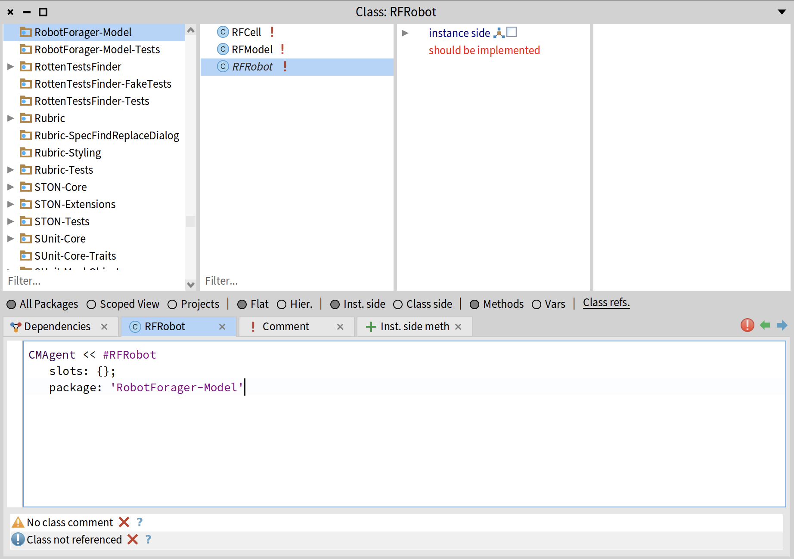

### Define the Robot's Appearance

Cormas uses **Point of View (PoV)** methods to define how agents appear in the simulation. You can define multiple PoVs for the same agent and switch between them at runtime.

In `RFRobot`, create a method called `pov`:

```smalltalk title="RFRobot"
pov
    <pov>
    ^ CMPointOfView
        color: CMColor blue
        shape: #star
        size: 0.6
```

This method defines:

- **Color:** Blue, using CMColor (Cormas' color palette).
- **Shape:** A star.
- **Size:** 0.6, or 60% of the cell size (the default is 0.3).

The `<pov>` pragma tells Cormas that this method defines a point of view. You can give the method any name, as long as it includes this pragma.

### Add Robots to the Grid

Now modify the `initSmall` method in RFModel to create two robots:

```smalltalk title="RFModel"
initSmall
    <init>
    self
        createGridNumberOfRows: 5
        numberOfColumns: 5
        neighbourhood: 8
        closed: true.

    /* highlight-next-line */
    self create: 2 randomlyLocatedAloneEntitiesOfClass: RFRobot
```

The new line creates two instances of `RFRobot`, placing them randomly on the grid. The `randomlyLocatedAloneEntities:` part ensures that each robot occupies a different cell.

### See the Result

Return to the Simulation Browser and click _"Initialize simulation"_ to restart the simulation.

You should now see two blue stars representing your robots, randomly positioned on the grid.

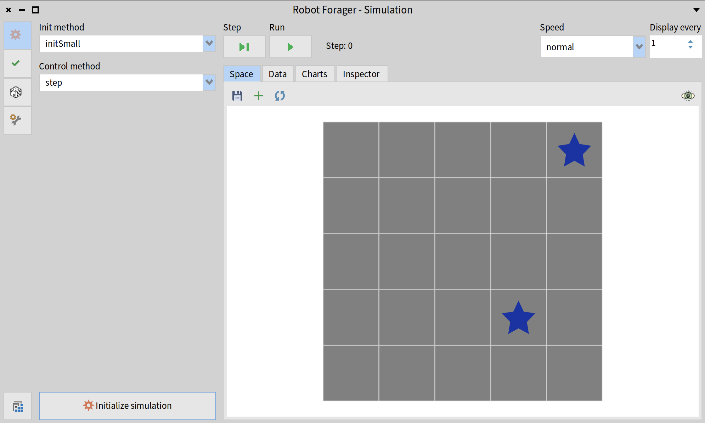

Congratulations! You have created your first Cormas agents. For now, they do nothing but exist in the simulation. In the next step, we will give them their first behavior.

## Step 5. Make robots move

Now let's give our robots their first behavior: moving randomly across the grid.

### Define an Action

In Cormas, **actions** are methods that agents can perform during a simulation. They are identified by the `<action>` pragma.

Create a new method called `moveRandomly` in the `RFRobot` class:

```smalltalk title="RFRobot"
moveRandomly
    <action>
    self randomWalk
```

The `randomWalk` method, provided by the superclass, moves the robot to a randomly selected neighboring cell.

### Make Robots Move at Each Step

Next, modify the step method in RFModel to make every robot perform this action:

```smalltalk title="RFModel"
step
    <control>
    /* highlight-next-line */
    (self @@ RFRobot) do: [ :each | each moveRandomly ]
```

The robots collection contains all robots in the model. The `do:` method iterates over this collection, sending `moveRandomly` to each robot.

Return to the Simulation Browser. You can now:

1. Click **Step** to execute one simulation step.
2. Click **Run** to run the simulation continuously at the selected speed.

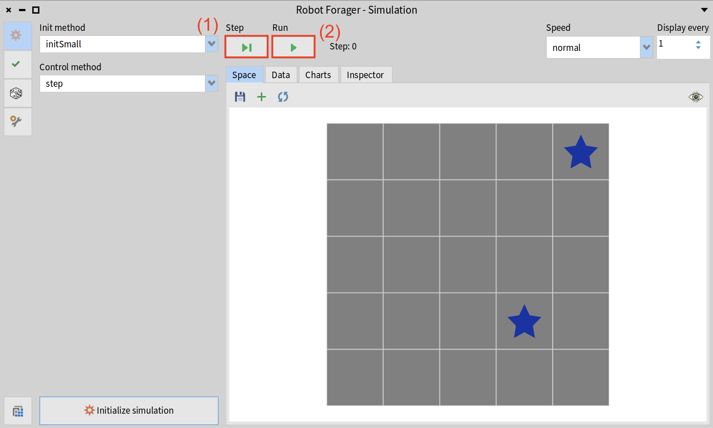

Since we added the `<action>` pragma to the `moveRandomly` method, Cormas has added it to the list of actions available to robots. If you right-click on any robot on the spatial grid, a menu will pop-up allowing you to perform this action. You can also _"Kill"_ a robot (destroy it and remove it from the simulation) or drag-n-drop it to a different location.

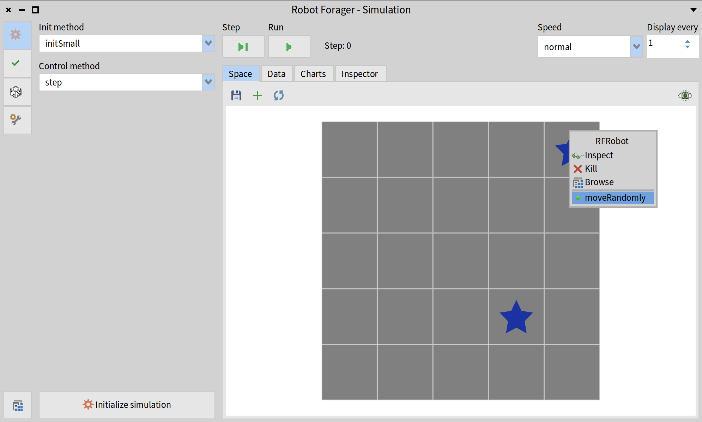

### Interact with Individual Robots

If you run the simulation long enough, you will notice a problem: sometimes robots move randomly into the same cell, even though, at the very beginning of this tutorial, we have specified that "Multiple robots should never appear on the same cell". To ensure that this doesn't happen, we modify the `moveRandomly` method and instead of calling the `randomWalk` method, we will call `randomWalkConstrainedBy:` - this method acceps a block as an argument allowing us to specify a condition for selecting candidate cells to which an agent can move. We will then use a method of cell called `hasOccupantsOfClass:` which returns `true` if the cell has at least one occupant of a given class. We will negate the result using the `not` method, thus specifying theat the candidate cell must **not** have any agents of class `RFRobot` in it.

```smalltalk title="RFRobot"
moveRandomly
    <action>
    self randomWalkConstrainedBy: [ :aCell |
        (aCell hasOccupantsOfClass: RFRobot) not ]
```
If you run the simulation again, the robots should move randomly but never come to the same cell.

## Step 7: Add minerals

In this tutorial, we will define minerals as agents. They will not do anything but this is just a simple way to locate them on a spatial grid. We start by adding a new subclass of `CMAgent` called `RFMineral`.

```smalltalk
CMAgent << #RFMineral
	slots: {};
	package: 'RobotForager-Model'
```

We define a `pov` method to specify that minerals should have the shape of _"diamond"_ their color should be _"gold"_.

```smalltalk title="RFMineral"
pov
	<pov>
	^ CMPointOfView
		color: CMColor gold
		shape: #diamond
```

Now we add another line at the end of the `initSmall` method and tell Cormas to create 20 minerals located randomly in the cells that are not occupied by aany other agents.

```smalltalk title="RFModel"
initSmall
    <init>
    self
        createGridNumberOfRows: 5
        numberOfColumns: 5
        neighbourhood: 8
        closed: true.

	self createN: 2 randomlyLocatedAloneEntities: RFRobot.
	/* highlight-next-line */
	self createN: 20 randomlyLocatedAloneEntities: RFMineral
```

If you re-initialize your simulation now, you should see 20 minerals as well as 2 robots.

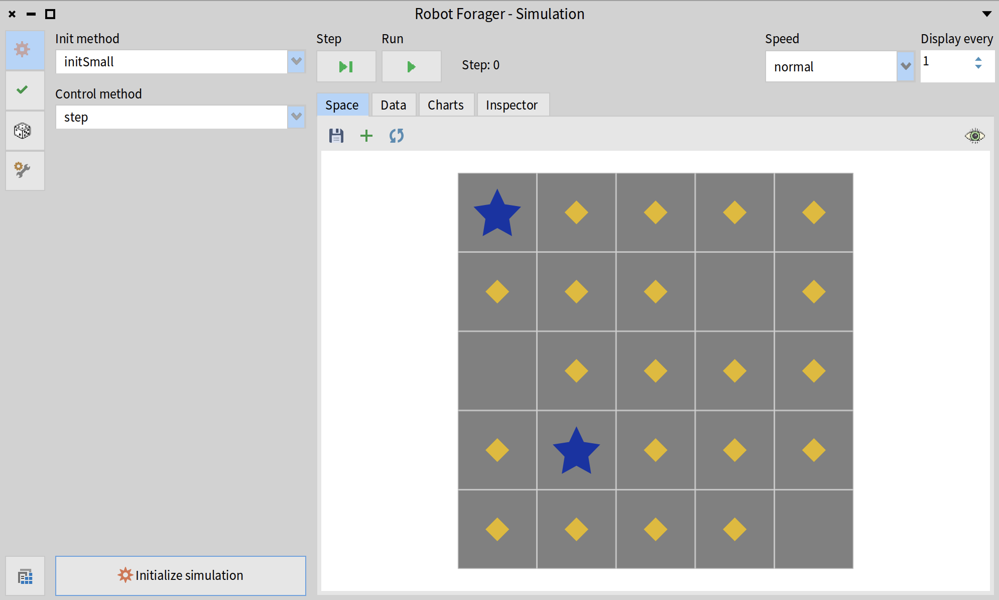

We will also add two helper methods to `RFCell` class that will be useful in the next sections. First, we add a method `hasMineral` which answers `true` if the cell has occupants of class `RFMineral`.

```smalltalk title="RFCell"
hasMineral
	^ self hasOccupantsOfClass: RFMineral
```

We also define a method `getMineral` that will return a mineral from the cell. The first line of this method checks if the cell has a mineral on it. If not, it signals an error.

```smalltalk title="RFCell"
getMineral
	self hasMineral ifFalse: [ self error: 'This cell has no minerals' ].
	^ (self occupantsOfClass: RFMineral) first
```

## Step 8. Make robots collect the minerals

We start by adding an instance variable `collectedMinerals` to `RFRobot` and adding a new `initialize` method to this class where we assign an empty `OrderedCollection` to `collectedMinerals` variable. We will use this collection to store the minerals that the robot has collected.

```smalltalk
CMAgent << #RFRobot
	/* highlight-next-line */
	slots: { #collectedMinerals };
	package: 'RobotForager-Model'
```
```smalltalk title="RFRobot"
initialize
	super initialize.
	collectedMinerals := OrderedCollection new
```

We provide an accessor for this collection because we will need to access it later to measure the number of collected minerals. Pay attention that in this case, we do not add the`<getterFor:>` pragma. It is only used by the model class to identify collections that should be managed by Cormas and store model entities such as agents or cells.

```smalltalk title="RFRobot"
collectedMinerals
	^ collectedMinerals
```

Now we must define two more actions for our robots: `move` and `collectMineral`.

The `move` action should make the robot look at the neighbouring cells, find one that contains a mineral and move there. If there are no minerals around, robot should move randomly. We access the neighbouring calls by first getting the cell at which a robot is currently located (this cell can be accessed using the `cell` method) and then calling the `neighbourhood` method of that cell.

```smalltalk title="RFRobot"
move
	<action>
	self cell neighbourhood
		detect: [ :each | each hasMineral ]
		ifFound: [ :each | self moveTo: each ]
		ifNone: [ self moveRandomly ]
```
The `collectMineral` action should make the robot collect minerals from the cell at which it is currently located. If there are no minerals, the robot should do nothing (`^ self` is a common way to stop the execution of a method). To collect the mineral, we add it to the `collectedMinerals` collection and remove it from the grid using the `leave` method. This method makes the agent leave from its current cell but keeps this agent in the simulation.

```smalltalk title="RFRobot"
collectMineral
	<action>
	| mineral |
	self cell hasMineral ifFalse: [ ^ self ]. 
	mineral := self cell getMineral.
	collectedMinerals add: mineral.
	mineral leave
```
Finally, we define the `step` action for our robots that will first perform the `move` action and then the `collectMineral` action.

```smalltalk title="RFRobot"
step
	<action>
	self move.
	self collectMineral
```
Update the `step` method of `RFModel` to call the `step` method of robots and not the `moveRandomly` method.

```smalltalk title="RFModel"
step
    <control>
    robots do: [ :each | each step ]
```

Now you can re-initialize your simulation (to make sure that the robots are re-created and their `collectedMineral` collections are initialized) and click on the _"Run"_ button. Your robots should start collecting minerals now.

If you right-click on any robot and then click on _"Inspect"_, you should be able to explore the `collectedMinerals` collection of that robot and see that it contains all the minerals that the robot has collected. 

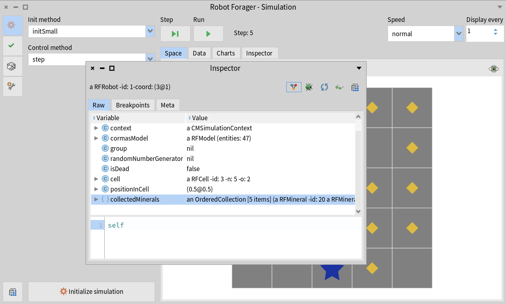

## Step 9. Add some probes

Probes are the methods that perform numerical measurements at every step of the simulation. They define the columns of a dataset that will be recorded. In this tutorial, we will add two probes to our model: one to measure the **number of collected minerals** and another one to measure the **number of remaining minerals**.

We start by adding a method `numberOfCollectedMinerals` to `RFModel` and adding a pragma `<probeNamed: color:>` to it. This pragma accepts two arguments: the probe name that will be displayed in the dataset and the hex code of a color that will be used for charting.

```smalltalk title="RFModel"
numberOfCollectedMinerals
	<probeNamed: 'Collected minerals' color: '00B44C'>
	^ robots sum: [ :each | each collectedMinerals size ]
```

The hex code in teh method above corresponds to `CMColor green`. You can get a hex code of any color in Pharo by sending a message `asHexString` to it. For example:

```smalltalk
CMColor green asHexString. "00B44C"
```

To implement the second probe, we count the number of minerals that are still located on the grid - the ones that have a `patch` (cell) which is not `nil`.

```smalltalk title="RFModel"
numberOfRemainingMinerals
	<probeNamed: 'Remaining minerals' color: 'E5B80B'>
	^ minerals count: [ :each | each patch isNotNil ]
```
You can now run the simulation and click on the _"Data"_ tab to see the dataset that is being collected.

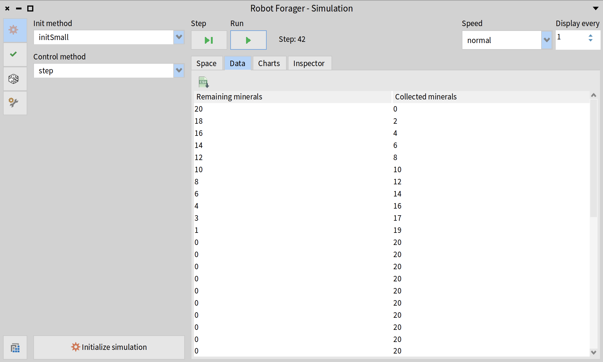

You can also click on the _"Charts"_ tab to get this data visualized.

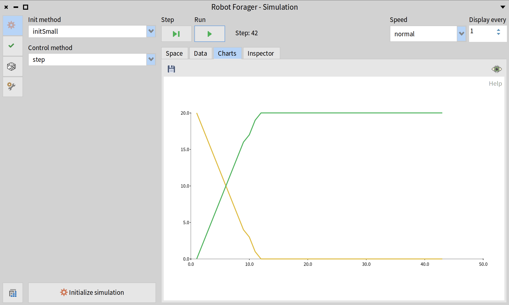

By clicking on the _"Probes"_ button (with the eye icon) in the top right corner of the _"Charts"_ page, you can select or unselect the probes that are being visualized.

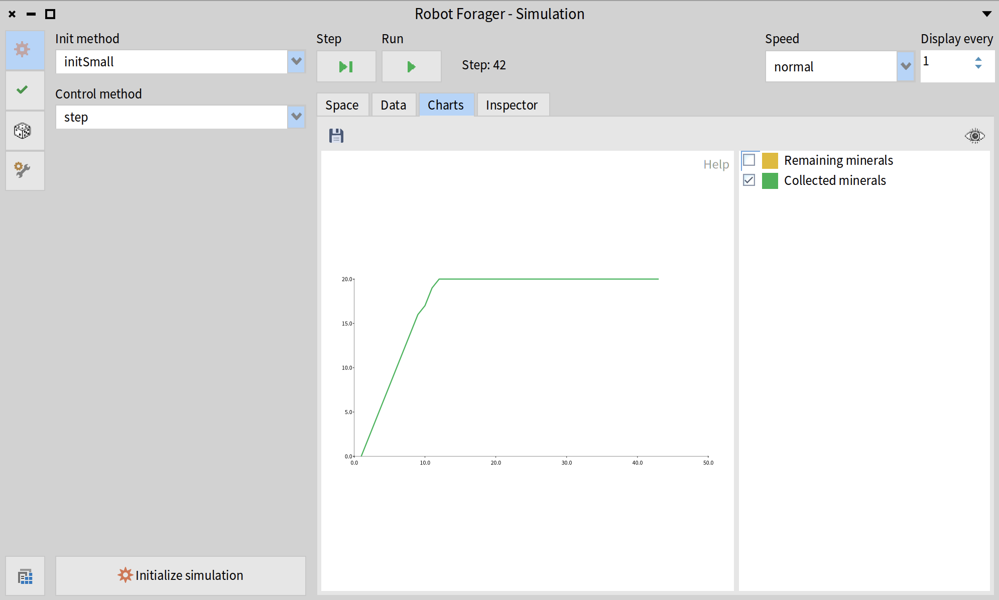

## Step 10. Define a larger environment

We have implemented a simple 5x5 grid with 2 robots and 20 minerals. Let us now implement a second init method that defines a large environment with 27x27 cells, 10 robots, and 200 minerals. To do that, we simply add another method with `<init>` pragma to the `RFModel`.

```smalltalk title="RFModel"
initLarge
	<init>
	self
        createGridNumberOfRows: 27
        numberOfColumns: 27
        neighbourhood: 8
        closed: true.

	self createN: 10 randomlyLocatedAloneEntities: RFRobot.
	self createN: 200 randomlyLocatedAloneEntities: RFMineral
```

Now you can open your simulation again and select `initLarge` from the dropdown list of init methods on the left. Initialize the simulation and run the simulation to see the results.

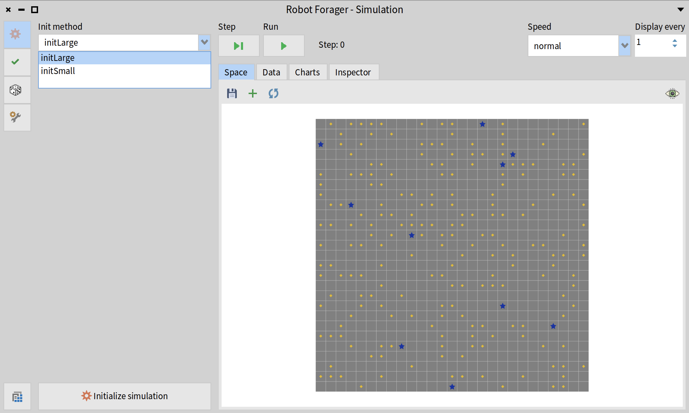

## Step 11. Define model parameters

You should have noticed that `initSmall` and `initLarge` have the same implementation but different numerical values (fun fact: such numbers inserted directly into the source code are called [magic numbers](https://en.wikipedia.org/wiki/Magic_number_(programming)), they are usually considered a bad practice).

We will replace them with model parameters - named constant values that can be accessed and dynamically modified during the simulation. To do that, we must first create 4 class side variables for our model: `numberOfRows`, `numberOfColumns`, `numberOfRobots`, and `numberOfMinerals`. Go to the class side by clicking on the _"Class side"_ button in your System Browser. Then add the array of slots to the class definition:

```smalltalk
CMAbstractModel class << RFModel class
	slots: { #numberOfRows . #numberOfColumns . #numberOfRobots . #numberOfMinerals }
```

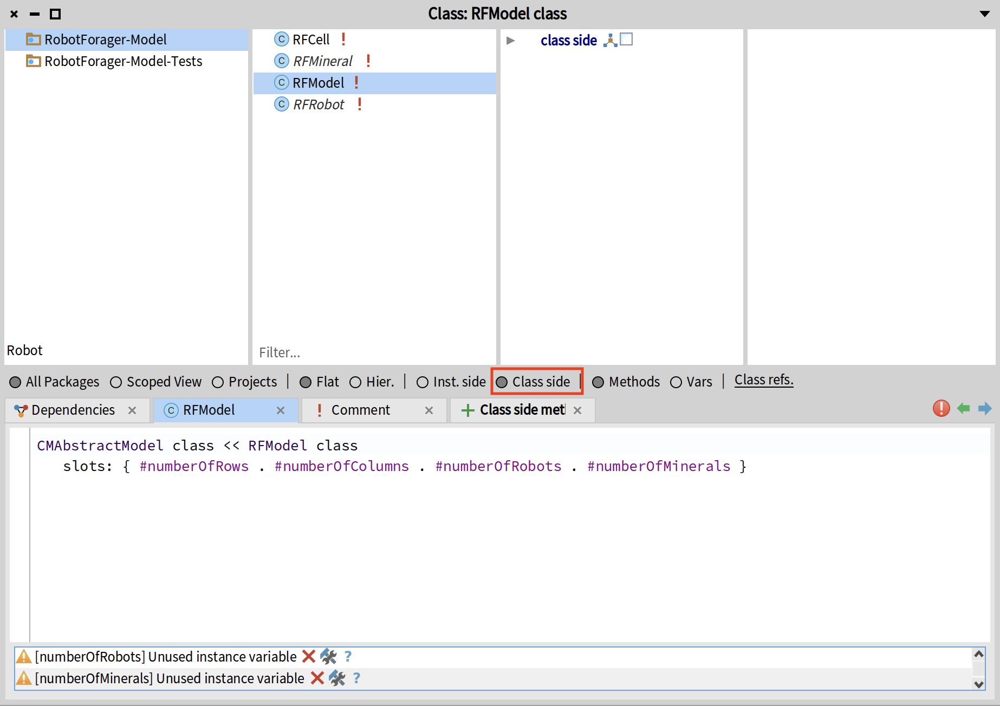

Now, while still on the class side, create a new method called `initializeParameters`. This is a special method that will be called by Cormas when the model is initialized. The first line of this method must always be `super initializeParameters`, to make sure that the superclass parameters are also initialized (same principle as for the `initialize` method of the instance side). In the following lines, provide the default values for each parameter.

```smalltalk title="RFModel class"
initializeParameters
	super initializeParameters.
	numberOfRows := 5.
	numberOfColumns := 5.
	numberOfRobots := 2.
	numberOfMinerals := 20
```

Make sure that you create this method on the class side and not the instance side (this is a common mistake!). If you do this correctly, you should see a little arrow near the method name indicating that the method is overriding the superclass implementation. You can click on this arrow to see the method of the superclass.

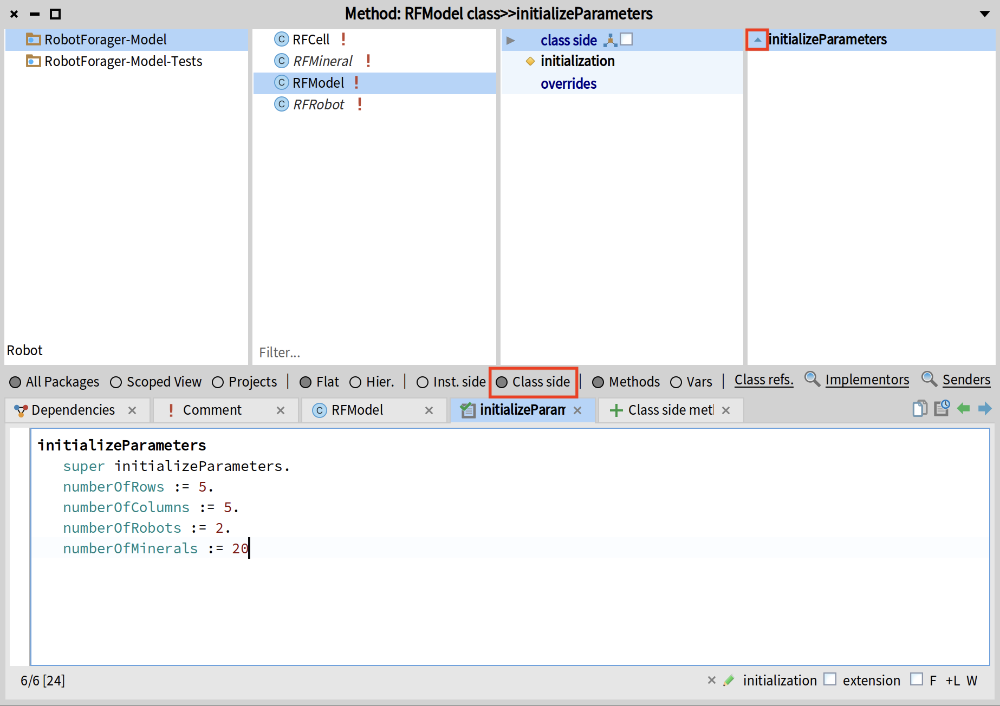

Now we need to create getter and setter accessors for each parameter. You can do this automatically by right-clicking on the class, selecting _"Generate accessors"_ from the menu and applying all the proposed refactoring changes. Once this is done, you should see 8 new methods: `numberOfRows`, `numberOfRows:`, `numberOfColumns`, etc.

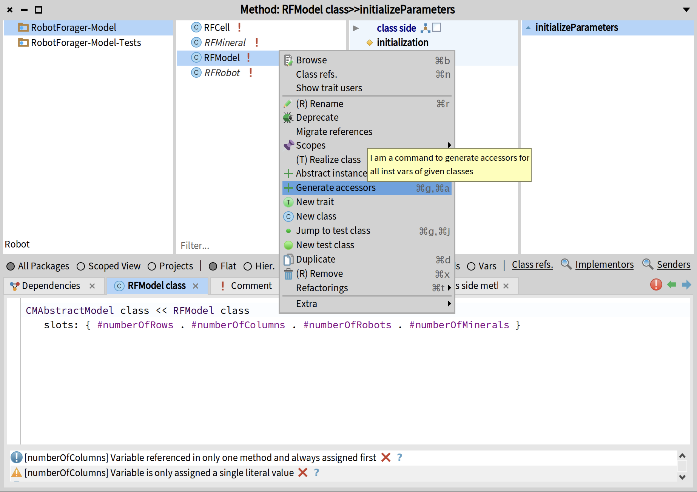

Now we create a parametrized init method that will use the parameters instead of numbers. To access the paramenters, we simply call the corresponding class side getter accessors. For example, we use `self class numberOfRows` instead of directly writing numbers `5` or `27`.

```smalltalk title="RFModel"
init
    <init>
    self
        createGridNumberOfRows: self class numberOfRows
        numberOfColumns: self class numberOfColumns
        neighbourhood: 8
        closed: true.

	self createN: self class numberOfRobots randomlyLocatedAloneEntities: RFRobot.
	self createN: self class numberOfMinerals randomlyLocatedAloneEntities: RFMineral
```

Now you can select the new `init` method from the list, and modify the parameters before initializing your model. To modify the parameter, click on the little pencil icon (1) on the left side of the Simulation window. This will open a _"Parameter Editor"_ allowing you to select the class which defines your parameter (2) and modify its value (3). Those numbers are editable text fields, so you can simply type the new values and they will be saved.

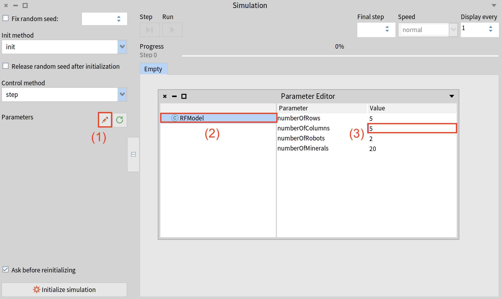

Try it yourself by setting the number of rows to 7, number of columns to 30, number of robots to 5 and number of minerals to 100. Once you have entered the values, you can close the editor, initialize the simulation and run it.

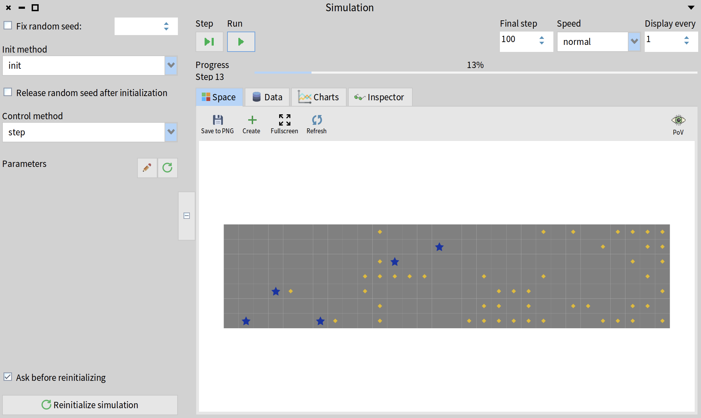

## Conclusion

This simple tutorial demonstrated the basic functionality of Cormas, teaching you how to create a simple model and run a simulation. Real-life models are often more complex but the underlying principles remain the same. 
