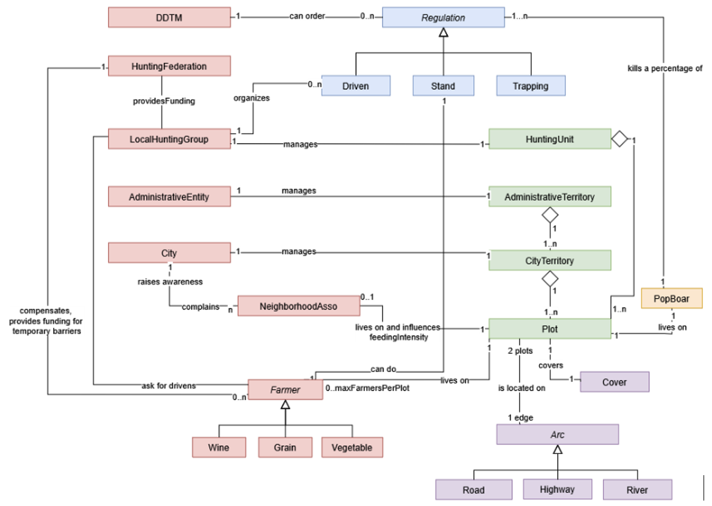

# Boundaryboar Model

:::info
This model was developed using [Cormas VisualWorks](https://vw.cormas.org).
:::

## Objectives

This model represents wild boar population dynamics in an urban/suburban area embedded within a broader landscape, as well as the effects of local stakeholders’ decisions on these dynamics. It was developed as part of the ANR Boundaryboar project with the following main objectives:

- To foster dialogue and the sharing of knowledge and perspectives between researchers and non-academic stakeholders involved in wild boar management, with a focus on social learning
- To explore management scenarios by testing different intervention strategies and discussing their implications.

This model was co-designed by the project researchers and stakeholders in the Montpellier region, including representatives of the hunting federation, hunting officers, and animal welfare associations.

The model balances a representation of the real-world territorial context with abstraction, using simplified land-use data from the European Corine Land Cover database. This makes it readily adaptable to other urban areas.

  <figure>
    
    <figcaption>Montpellier urban area</figcaption>
  </figure>

  <figure>
    
    <figcaption>Nîmes urban area</figcaption>
  </figure>

## Description

The model represents interactions between territorial elements (green), landscape-structuring elements (purple), wild boar populations (orange), human actors (red), and direct management actions (blue).

In this model, we have incorporated a variety of levers that influence population dynamics and can be adjusted to explore management scenarios: hunting strategies, access to anthropogenic food sources in urban areas (trash and direct feeding of animals), scrub encroachment, supplementary feeding practices, and targeted interventions. We have also included the option to consider the issue of agricultural damage and ways to protect crops.

## Usage

Up to time step t = 28, the simulator operates retrospectively to reconstruct the current situation from historical dynamics. This corresponds to the period from 1990 to 2018. During this parameter calibration phase, the simulator serves as a tool for reflection and discussion among stakeholders to reconstruct a recent situation consistent with their on-the-ground knowledge.

After t=28, the simulator can be used in several ways: as a tool for reflecting on various possible management measures, as a tool for role-playing, and to explore different governance scenarios.

