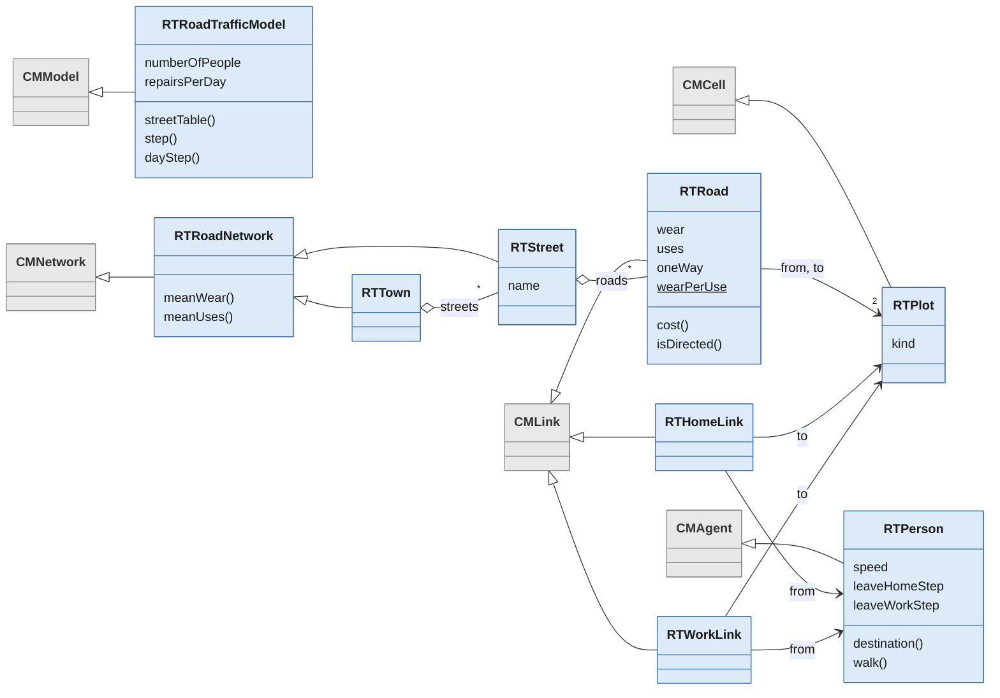

import townStartImg from './img/town-start.png'
import morningCommuteImg from './img/morning-commute.png'
import streetsImg from './img/streets.png'
import chartsImg from './img/charts.png'

# Road Traffic Model

People commute between home and work along a network of roads. Roads wear out with use, which slows people down and pushes traffic onto other routes, and every day a council repairs the most worn roads.

The story comes from the [Road Traffic tutorial of GAMA](https://gama-platform.org/wiki/RoadTrafficModel), adapted to a grid of cells. It keeps the same mechanisms with its own numbers, and does not try to reproduce GAMA's results. The model is an example of how to use links and networks of links in Cormas. Its code is on GitHub at [cormas/road-traffic-model](https://github.com/cormas/road-traffic-model).

## The model

### The town

The town is a grid of 50 by 50 plots. Most plots are empty land. 8 plots are residential, where people live, and 3 are industrial, where people work.

A **road** is a straight segment between two plots, usually many plots apart, and it can run at any angle. A **street** is a chain of roads with a name. It runs from one end to the other, or round in a loop, and never branches: a road meeting a street at a junction belongs to another street. The **town** is made of 16 streets, with 43 roads in total. The map is drawn by hand.

The town can be created in two ways: with all roads open in both directions, or with 4 streets that are one-way along their whole length.


### People

30 people live in the town. Each has a home on a residential plot and a workplace on an industrial plot, chosen at random, and starts at home.

### Time

A day lasts 100 steps. Each person draws two times once, at the start: when they leave home, between steps 10 and 25 of the day, and when they leave work, between steps 60 and 80. Where a person is going depends only on the time of day: to work between those two times, and home otherwise. So someone who has not reached work by the time they should leave it turns round at the next junction.

### Moving

At every junction, a person who has not arrived takes the first road of the **cheapest route** to where they are going. The cost of a road is its length in cells multiplied by its wear, so people avoid worn roads when another route is cheaper. They choose again at every junction, so a route changes as roads wear or get repaired.

People walk along the drawn line of the road, 2.5 to 3.5 cells per step on an unworn road, each at their own speed. On a road with a wear of 2, they walk half as fast.

### Wear and repairs

A road starts with a wear of 1, and each person entering it adds 0.02. At the start of each day, the council resets the 5 most worn roads to a wear of 1.

### One step

At each step:

1. On the first step of a day, the council repairs the most worn roads.
2. Each person takes a turn:
   - A person who is not on a road chooses one. A person who has arrived stays where they are.
   - The person moves `speed ÷ wear` along the road, towards its far end.
   - On reaching the far end, the person chooses the next road, and walks on it from the next step.

To choose a road, a person looks at where they should be going at this time of day. If they are already there, they take no road. Otherwise they take the first road of the cheapest route, and that road wears a little.

## Running the model

The model needs a version of Cormas with links and networks, which for now is the `dev` branch. Get Cormas by following the instructions on the [Download](/download) page. Then open a Playground in your image and execute:

```Smalltalk
Metacello new
    repository: 'github://cormas/road-traffic-model:main/src';
    baseline: 'RoadTrafficModel';
    load.
```

To open a simulation window, Select "Models in this image" from the Cormas menu, then "Road Traffic Model" from the list of models and click "Simulate".

Then choose an init method and the control method `step`, click on `Initialize simulation`, and run.

| Init method | Town |
|---|---|
| `initTown` | All roads open in both directions |
| `initTownWithOneWays` | The same town, with 4 one-way streets |

### Parameters

| Parameter | Where | Default | Meaning |
|---|---|---|---|
| `numberOfPeople` | `RTRoadTrafficModel` | 30 | People in the town |
| `repairsPerDay` | `RTRoadTrafficModel` | 5 | Roads repaired at the start of each day |
| `wearPerUse` | `RTRoad` | 0.02 | Wear added each time a person enters a road |

## Exploring the model

### What you see

| On the map | Meaning |
|---|---|
| Road from green to red | Wear, fully red from a wear of 2.5 |
| Thicker road | More traffic so far, compared with the busiest road |
| Light amber person | Going home, or at home |
| Light blue person | Going to work, or at work |
| Deep amber plot | Residential |
| Deep blue plot | Industrial |

One-way roads have an arrowhead at the end they lead to.


### Points of view

Roads have three points of view: `povWearAndTraffic`, the default, which shows both wear and traffic, `povWear` and `povTraffic`.

Streets and the town can also decide how their roads look. The outermost one with a point of view other than `pov` wins, so selecting a point of view for roads seems to do nothing while one is selected for streets or the town:

| To see | `RTTown` | `RTStreet` | `RTRoad` |
|---|---|---|---|
| How worn and busy the whole town is, as one color and width | `povWearAndTraffic` | Anything | Anything |
| How worn and busy each street is | `pov` | `povWearAndTraffic` | Anything |
| Which roads make up each street, each street in a color of its own | `pov` | `povStreet` | Anything |
| Each road | `pov` | `pov` | Any of its points of view |


To see who lives and works where, select `pov` for `RTHomeLink` and `RTWorkLink`. They are hidden when the town is created, because 60 lines would hide the roads.

### Charts

The charts follow the mean and the maximum wear of the roads, and the number of people at home, at work and on the road. With the default parameters, the mean wear rises quickly over the first days, then more and more slowly, and fewer people are back home at the end of each day.


### Things to try

- Set `repairsPerDay` to 2, then to 8, and run for 20 days. How worn does the town get, and how many people get to work on time?
- Set `repairsPerDay` to 0. What happens to the daily rhythm in the charts?
- Compare `initTown` with `initTownWithOneWays`. Which roads get busier?
- Change `numberOfPeople` or `wearPerUse`. Is there a point where the town stops working?
- The cost of a road counts its length in grid steps, where a diagonal step counts as one cell, but people walk the real distance along the line. Make the cost use the real length of the road. Do the routes change?
- Add a street to `streetTable` in `RTRoadTrafficModel`, or remove one. The model's tests check that everyone can still get to work and back.
- Harder: replace the daily repairs with a repair crew, an agent that walks to the most worn road and repairs it when it arrives.

## How it is built

| In the model | In Cormas | Class |
|---|---|---|
| Plot | A cell | `RTPlot` |
| Person | An agent | `RTPerson` |
| Road | A link between two plots | `RTRoad` |
| Home and workplace | Links from a person to a plot | `RTHomeLink`, `RTWorkLink` |
| Street | A network of roads | `RTStreet` |
| Town | A network of streets | `RTTown` |
| The simulation, its map and its parameters | A model | `RTRoadTrafficModel` |



Cormas classes are grey, and the model's classes are blue.

**Three levels.** Cormas organizes connections in three levels, and each level refers only to the level below it. Things are cells, agents and aggregates: here, plots and people. A link connects two things: a road joins two plots, and a home link joins a person to a plot. A network collects links and other networks: a street holds roads, and the town holds streets. A link or a network is not a thing, so neither can be an end of a link.

**Links with their own attributes.** A road has its own wear, uses and points of view, like any other entity. It joins plots that are far apart, which cells alone cannot do. A person finds their home by following their home link, and naming the link class keeps the question away from the roads that join the same plots.

**Finding a way in a network.** The cheapest route is found by Cormas, which searches for the cheapest way through the town, with the cost of each road at that moment. Searching in the town means that home and work links are never part of a route.

**Direction as an attribute.** A link is directed or not. A road is directed only when it is one-way, and routes follow arrows with no special code.

**Days made of steps.** Cormas has no days, months or years. Here, a Cormas step is a small part of a day, so the view and the charts update while people walk. The model works out the step of the day from the current step, and runs the daily repairs when a new day starts. The same pattern works for months and years. The alternative, one Cormas step per day with a loop inside, would update the view once a day, and people would seem to jump from home to work.

## See also

{/* NETWORKS LINK: replace the second item with a link to /docs/reference/networks once that page exists. onBrokenLinks is 'throw', so a link to a missing page would break the build. */}

- [Links](/docs/reference/links), the reference page on links between entities
- Networks, the reference page on networks of links (coming soon)
- [Road Traffic tutorial of GAMA](https://gama-platform.org/wiki/RoadTrafficModel), the model this one comes from
